# مخطط علاقات قاعدة بيانات عون — ERD

127 جدولًا، 289 علاقة مفتاح أجنبي، 14 قسمًا. السكيما وفق الترحيلات 001–039.

[تفاصيل السكيما والأعمدة](Schema-Diagram.md) · [ملف SQL الكامل](queries.sql)

الرسومات التالية بصيغة Mermaid وتظهر مباشرة على GitHub. استُخدم `schema__Table` لتمييز أسماء الجداول؛ مثل `learning__Plan` يعني `learning.Plan`. يظهر كل مفتاح أجنبي ضمن قسم الجدول الذي يحتويه.

`||` واحد مطلوب، `|o` صفر أو واحد، `o{` صفر أو أكثر، `o|` صفر أو واحد. تحديد الحد الأقصى مبني على المفاتيح الأساسية والفهارس الفريدة غير المشروطة، ولا يفترض وجود سجلات مرتبطة لكل صف أب.

## academic

12 جدولًا · 29 علاقة.

```mermaid
erDiagram
    academic__Building
    academic__ClassSection
    academic__CurriculumProgram
    academic__GradeLevel
    academic__PeriodDefinition
    academic__ProgramGrade
    academic__Room
    academic__Stage
    academic__Subject
    academic__SupervisionScope
    academic__TeachingAssignment
    academic__TimetableLesson
    core__AcademicTerm
    core__School
    core__SchoolYear
    people__EmployeeProfile
    security__UserAccount
    core__School ||..o{ academic__Building : "FK_Building_School"
    academic__GradeLevel ||..o{ academic__ClassSection : "FK_ClassSection_Grade"
    core__SchoolYear ||..o{ academic__ClassSection : "FK_ClassSection_Year"
    core__School ||..o{ academic__CurriculumProgram : "FK_CurriculumProgram_School"
    core__School ||..o{ academic__GradeLevel : "FK_GradeLevel_School"
    academic__Stage ||..o{ academic__GradeLevel : "FK_GradeLevel_Stage"
    core__School ||..o{ academic__PeriodDefinition : "FK_Period_School"
    academic__GradeLevel ||..o{ academic__ProgramGrade : "FK_ProgramGrade_Grade"
    academic__CurriculumProgram ||..o{ academic__ProgramGrade : "FK_ProgramGrade_Program"
    core__School ||..o{ academic__ProgramGrade : "FK_ProgramGrade_School"
    academic__Building |o..o{ academic__Room : "FK_Room_Building"
    core__School ||..o{ academic__Room : "FK_Room_School"
    core__School ||..o{ academic__Stage : "FK_Stage_School"
    core__School ||..o{ academic__Subject : "FK_Subject_School"
    academic__Stage |o..o{ academic__Subject : "FK_Subject_Stage"
    security__UserAccount ||..o{ academic__SupervisionScope : "FK_SupervisionScope_Actor"
    people__EmployeeProfile |o..o{ academic__SupervisionScope : "FK_SupervisionScope_Employee"
    core__School ||..o{ academic__SupervisionScope : "FK_SupervisionScope_School"
    academic__Subject |o..o{ academic__SupervisionScope : "FK_SupervisionScope_Subject"
    security__UserAccount ||..o{ academic__SupervisionScope : "FK_SupervisionScope_User"
    academic__ClassSection ||..o{ academic__TeachingAssignment : "FK_TeachingAssignment_Class"
    people__EmployeeProfile ||..o{ academic__TeachingAssignment : "FK_TeachingAssignment_Employee"
    academic__Subject ||..o{ academic__TeachingAssignment : "FK_TeachingAssignment_Subject"
    core__AcademicTerm ||..o{ academic__TeachingAssignment : "FK_TeachingAssignment_Term"
    core__SchoolYear ||..o{ academic__TeachingAssignment : "FK_TeachingAssignment_Year"
    academic__TeachingAssignment ||..o{ academic__TimetableLesson : "FK_TimetableLesson_Assignment"
    academic__TeachingAssignment ||..o{ academic__TimetableLesson : "FK_TimetableLesson_AssignmentTerm"
    academic__PeriodDefinition ||..o{ academic__TimetableLesson : "FK_TimetableLesson_Period"
    academic__Room |o..o{ academic__TimetableLesson : "FK_TimetableLesson_Room"
```

## admissions

2 جدولًا · 6 علاقة.

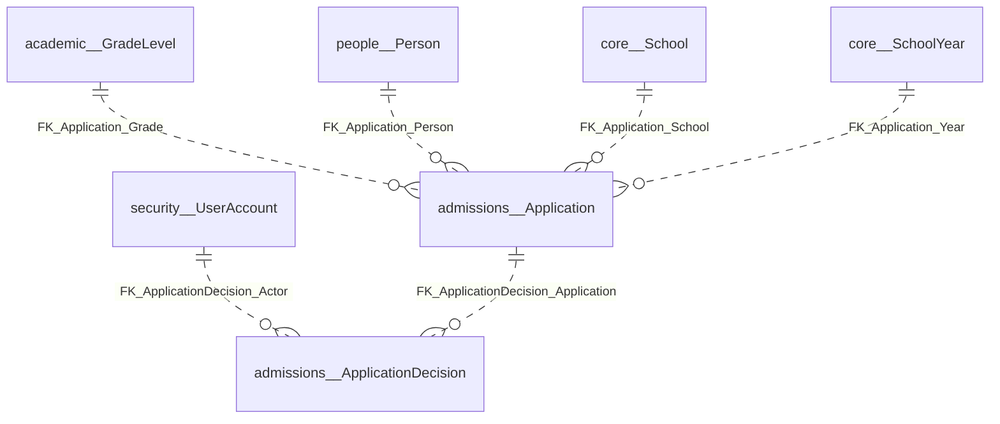

## assessment

21 جدولًا · 54 علاقة.

```mermaid
erDiagram
    academic__GradeLevel
    academic__Stage
    academic__Subject
    academic__TeachingAssignment
    assessment__Certificate
    assessment__Exam
    assessment__ExamAttempt
    assessment__ExamQuestion
    assessment__ExamResponse
    assessment__ExamResponseRevision
    assessment__ExamReview
    assessment__GradeItem
    assessment__GradeItemRevision
    assessment__GradePublication
    assessment__Gradebook
    assessment__GradebookEnrollment
    assessment__GradebookWorkflowEvent
    assessment__GradingComponent
    assessment__GradingLevel
    assessment__GradingPolicy
    assessment__PolicyReview
    assessment__PublishedGrade
    assessment__Question
    assessment__QuestionOption
    assessment__ReopenRequest
    core__AcademicTerm
    core__School
    core__SchoolYear
    people__StudentEnrollment
    security__UserAccount
    assessment__PublishedGrade ||..o{ assessment__Certificate : "FK_Certificate_Grade"
    core__School ||..o{ assessment__Exam : "FK_Exam_School"
    academic__TeachingAssignment ||..o{ assessment__Exam : "FK_Exam_Teaching"
    people__StudentEnrollment ||..o{ assessment__ExamAttempt : "FK_ExamAttempt_Enrollment"
    assessment__Exam ||..o{ assessment__ExamAttempt : "FK_ExamAttempt_Exam"
    core__School ||..o{ assessment__ExamAttempt : "FK_ExamAttempt_School"
    assessment__Exam ||..o{ assessment__ExamQuestion : "FK_ExamQuestion_Exam"
    assessment__Question ||..o{ assessment__ExamQuestion : "FK_ExamQuestion_Question"
    core__School ||..o{ assessment__ExamQuestion : "FK_ExamQuestion_School"
    assessment__ExamAttempt ||..o{ assessment__ExamResponse : "FK_ExamResponse_Attempt"
    assessment__ExamQuestion ||..o{ assessment__ExamResponse : "FK_ExamResponse_Question"
    core__School ||..o{ assessment__ExamResponse : "FK_ExamResponse_School"
    security__UserAccount ||..o{ assessment__ExamResponseRevision : "FK_ExamResponseRevision_Actor"
    assessment__ExamResponse ||..o{ assessment__ExamResponseRevision : "FK_ExamResponseRevision_Response"
    security__UserAccount ||..o{ assessment__ExamReview : "FK_ExamReview_Actor"
    assessment__Exam ||..o{ assessment__ExamReview : "FK_ExamReview_Exam"
    security__UserAccount ||..o{ assessment__Gradebook : "FK_Gradebook_Creator"
    assessment__GradingPolicy ||..o{ assessment__Gradebook : "FK_Gradebook_Policy"
    academic__TeachingAssignment ||..o{ assessment__Gradebook : "FK_Gradebook_Teaching"
    assessment__Gradebook ||--o{ assessment__GradebookEnrollment : "FK_GradebookEnrollment_Book"
    people__StudentEnrollment ||--o{ assessment__GradebookEnrollment : "FK_GradebookEnrollment_Enrollment"
    security__UserAccount ||..o{ assessment__GradebookWorkflowEvent : "FK_GradebookEvent_Actor"
    assessment__Gradebook ||..o{ assessment__GradebookWorkflowEvent : "FK_GradebookEvent_Gradebook"
    assessment__GradingComponent ||..o{ assessment__GradeItem : "FK_GradeItem_Component"
    people__StudentEnrollment ||..o{ assessment__GradeItem : "FK_GradeItem_Enrollment"
    assessment__Gradebook ||..o{ assessment__GradeItem : "FK_GradeItem_Gradebook"
    assessment__GradebookEnrollment ||..o{ assessment__GradeItem : "FK_GradeItem_Roster"
    security__UserAccount ||..o{ assessment__GradeItem : "FK_GradeItem_Updater"
    security__UserAccount ||..o{ assessment__GradeItemRevision : "FK_GradeItemRevision_Actor"
    assessment__Gradebook ||..o{ assessment__GradeItemRevision : "FK_GradeItemRevision_Book"
    assessment__GradingComponent ||..o{ assessment__GradeItemRevision : "FK_GradeItemRevision_Component"
    people__StudentEnrollment ||..o{ assessment__GradeItemRevision : "FK_GradeItemRevision_Enrollment"
    assessment__Gradebook ||..o{ assessment__GradePublication : "FK_GradePublication_Gradebook"
    security__UserAccount ||..o{ assessment__GradePublication : "FK_GradePublication_Publisher"
    assessment__GradingPolicy ||..o{ assessment__GradingComponent : "FK_GradingComponent_Policy"
    assessment__GradingPolicy ||--o{ assessment__GradingLevel : "FK_GradingLevel_Policy"
    security__UserAccount ||..o{ assessment__GradingPolicy : "FK_GradingPolicy_Author"
    academic__GradeLevel |o..o{ assessment__GradingPolicy : "FK_GradingPolicy_Grade"
    academic__Stage ||..o{ assessment__GradingPolicy : "FK_GradingPolicy_Stage"
    academic__Subject |o..o{ assessment__GradingPolicy : "FK_GradingPolicy_Subject"
    core__AcademicTerm ||..o{ assessment__GradingPolicy : "FK_GradingPolicy_Term"
    core__SchoolYear ||..o{ assessment__GradingPolicy : "FK_GradingPolicy_Year"
    security__UserAccount ||..o{ assessment__PolicyReview : "FK_PolicyReview_Actor"
    assessment__GradingPolicy ||..o{ assessment__PolicyReview : "FK_PolicyReview_Policy"
    people__StudentEnrollment ||--o{ assessment__PublishedGrade : "FK_PublishedGrade_Enrollment"
    assessment__GradePublication ||--o{ assessment__PublishedGrade : "FK_PublishedGrade_Publication"
    security__UserAccount ||..o{ assessment__Question : "FK_Question_Author"
    core__School ||..o{ assessment__Question : "FK_Question_School"
    academic__Subject ||..o{ assessment__Question : "FK_Question_Subject"
    assessment__Question ||..o{ assessment__QuestionOption : "FK_QuestionOption_Question"
    core__School ||..o{ assessment__QuestionOption : "FK_QuestionOption_School"
    security__UserAccount |o..o{ assessment__ReopenRequest : "FK_ReopenRequest_Decider"
    assessment__Gradebook ||..o{ assessment__ReopenRequest : "FK_ReopenRequest_Gradebook"
    security__UserAccount ||..o{ assessment__ReopenRequest : "FK_ReopenRequest_Requester"
```

## attendance

8 جدولًا · 23 علاقة.

```mermaid
erDiagram
    academic__ClassSection
    academic__PeriodDefinition
    academic__TimetableLesson
    attendance__AttendanceSession
    attendance__CoverAssignment
    attendance__EmployeeAttendance
    attendance__LeaveDecision
    attendance__LeaveEntitlement
    attendance__LeaveRequest
    attendance__LeaveUsage
    attendance__StudentAttendance
    core__FileObject
    core__School
    people__EmployeeProfile
    people__StudentEnrollment
    security__UserAccount
    academic__ClassSection |o..o{ attendance__AttendanceSession : "FK_AttendanceSession_Class"
    academic__TimetableLesson |o..o{ attendance__AttendanceSession : "FK_AttendanceSession_Lesson"
    academic__PeriodDefinition |o..o{ attendance__AttendanceSession : "FK_AttendanceSession_Period"
    core__School ||..o{ attendance__AttendanceSession : "FK_AttendanceSession_School"
    security__UserAccount ||..o{ attendance__AttendanceSession : "FK_AttendanceSession_Taker"
    security__UserAccount ||..o{ attendance__CoverAssignment : "FK_Cover_Assigner"
    attendance__LeaveRequest ||..o{ attendance__CoverAssignment : "FK_Cover_Leave"
    academic__TimetableLesson ||..o{ attendance__CoverAssignment : "FK_Cover_Lesson"
    people__EmployeeProfile ||..o{ attendance__CoverAssignment : "FK_Cover_Substitute"
    people__EmployeeProfile ||..o{ attendance__EmployeeAttendance : "FK_EmployeeAttendance_Employee"
    security__UserAccount ||..o{ attendance__EmployeeAttendance : "FK_EmployeeAttendance_Recorder"
    security__UserAccount ||..o{ attendance__LeaveDecision : "FK_LeaveDecision_Actor"
    attendance__LeaveRequest ||..o{ attendance__LeaveDecision : "FK_LeaveDecision_Request"
    people__EmployeeProfile ||..o{ attendance__LeaveEntitlement : "FK_LeaveEntitlement_Employee"
    core__School ||..o{ attendance__LeaveEntitlement : "FK_LeaveEntitlement_School"
    people__EmployeeProfile ||..o{ attendance__LeaveRequest : "FK_LeaveRequest_Employee"
    core__FileObject |o..o{ attendance__LeaveRequest : "FK_LeaveRequest_File"
    attendance__LeaveEntitlement ||..o{ attendance__LeaveUsage : "FK_LeaveUsage_Entitlement"
    attendance__LeaveRequest ||..o| attendance__LeaveUsage : "FK_LeaveUsage_Request"
    core__School ||..o{ attendance__LeaveUsage : "FK_LeaveUsage_School"
    people__StudentEnrollment ||..o{ attendance__StudentAttendance : "FK_StudentAttendance_Enrollment"
    security__UserAccount ||..o{ attendance__StudentAttendance : "FK_StudentAttendance_Recorder"
    attendance__AttendanceSession ||..o{ attendance__StudentAttendance : "FK_StudentAttendance_Session"
```

## audit

1 جدولًا · 3 علاقة.

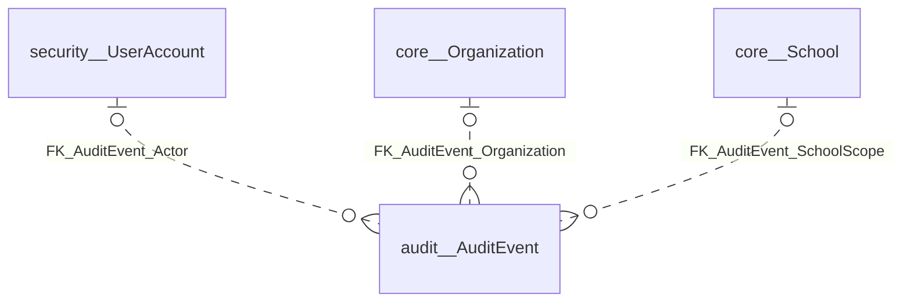

## core

8 جدولًا · 7 علاقة.

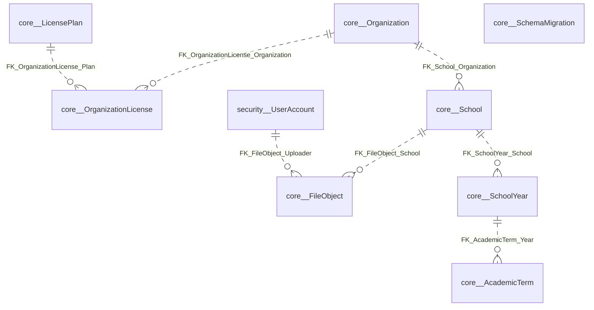

## finance

11 جدولًا · 21 علاقة.

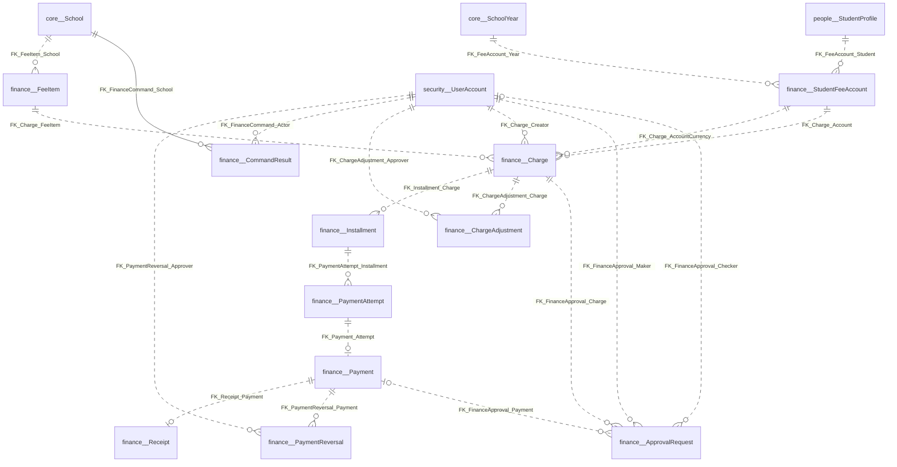

## health

2 جدولًا · 5 علاقة.

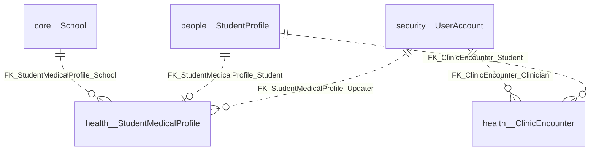

## hr

5 جدولًا · 10 علاقة.

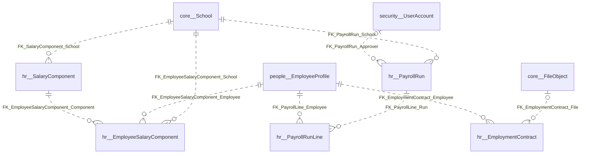

## learning

23 جدولًا · 58 علاقة.

```mermaid
erDiagram
    academic__ClassSection
    academic__GradeLevel
    academic__Stage
    academic__Subject
    academic__TeachingAssignment
    core__FileObject
    core__School
    learning__Assignment
    learning__AssignmentFile
    learning__Circular
    learning__CircularAcknowledgement
    learning__CircularAudience
    learning__Conversation
    learning__ConversationMember
    learning__Message
    learning__Notification
    learning__Plan
    learning__PlanProgress
    learning__PlanReview
    learning__PlanVersion
    learning__Resource
    learning__ResourceFile
    learning__Rubric
    learning__RubricCriterion
    learning__Submission
    learning__SubmissionReview
    learning__SubmissionRevision
    learning__SubmissionRevisionFile
    learning__SupervisoryVisit
    learning__VisitRating
    people__EmployeeProfile
    people__StudentEnrollment
    security__Role
    security__UserAccount
    security__UserAccount ||..o{ learning__Assignment : "FK_Assignment_Creator"
    academic__TeachingAssignment ||..o{ learning__Assignment : "FK_Assignment_Teaching"
    learning__Assignment ||..o{ learning__AssignmentFile : "FK_AssignmentFile_Assignment"
    core__FileObject ||..o{ learning__AssignmentFile : "FK_AssignmentFile_File"
    security__UserAccount ||..o{ learning__Circular : "FK_Circular_Creator"
    core__School ||..o{ learning__Circular : "FK_Circular_School"
    learning__Circular ||--o{ learning__CircularAcknowledgement : "FK_CircularAck_Circular"
    security__UserAccount ||--o{ learning__CircularAcknowledgement : "FK_CircularAck_User"
    learning__Circular ||..o{ learning__CircularAudience : "FK_CircularAudience_Circular"
    academic__ClassSection |o..o{ learning__CircularAudience : "FK_CircularAudience_Class"
    academic__GradeLevel |o..o{ learning__CircularAudience : "FK_CircularAudience_Grade"
    security__Role |o..o{ learning__CircularAudience : "FK_CircularAudience_Role"
    security__UserAccount ||..o{ learning__Conversation : "FK_Conversation_Author"
    core__School ||..o{ learning__Conversation : "FK_Conversation_School"
    learning__Conversation ||..o{ learning__ConversationMember : "FK_ConversationMember_Conversation"
    core__School ||..o{ learning__ConversationMember : "FK_ConversationMember_School"
    security__UserAccount ||..o{ learning__ConversationMember : "FK_ConversationMember_User"
    core__FileObject |o..o{ learning__Message : "FK_Message_File"
    learning__ConversationMember ||..o{ learning__Message : "FK_Message_Member"
    core__School ||..o{ learning__Message : "FK_Message_School"
    security__UserAccount ||..o{ learning__Notification : "FK_Notification_Recipient"
    core__School ||..o{ learning__Notification : "FK_Notification_School"
    academic__TeachingAssignment ||..o{ learning__Plan : "FK_Plan_Assignment"
    security__UserAccount ||..o{ learning__PlanProgress : "FK_PlanProgress_Actor"
    learning__Plan ||--o| learning__PlanProgress : "FK_PlanProgress_Plan"
    security__UserAccount ||..o{ learning__PlanReview : "FK_PlanReview_Reviewer"
    learning__PlanVersion ||..o{ learning__PlanReview : "FK_PlanReview_Version"
    security__UserAccount ||..o{ learning__PlanVersion : "FK_PlanVersion_Author"
    learning__Plan ||..o{ learning__PlanVersion : "FK_PlanVersion_Plan"
    security__UserAccount ||..o{ learning__Resource : "FK_Resource_Creator"
    core__School ||..o{ learning__Resource : "FK_Resource_School"
    academic__Subject |o..o{ learning__Resource : "FK_Resource_Subject"
    academic__TeachingAssignment |o..o{ learning__Resource : "FK_Resource_TargetAssignment"
    academic__ClassSection |o..o{ learning__Resource : "FK_Resource_TargetClass"
    academic__GradeLevel |o..o{ learning__Resource : "FK_Resource_TargetGrade"
    academic__Stage |o..o{ learning__Resource : "FK_Resource_TargetStage"
    core__FileObject ||--o{ learning__ResourceFile : "FK_ResourceFile_File"
    learning__Resource ||--o{ learning__ResourceFile : "FK_ResourceFile_Resource"
    core__School ||..o{ learning__Rubric : "FK_Rubric_School"
    learning__Rubric ||..o{ learning__RubricCriterion : "FK_RubricCriterion_Rubric"
    core__School ||..o{ learning__RubricCriterion : "FK_RubricCriterion_School"
    learning__Assignment ||..o{ learning__Submission : "FK_Submission_Assignment"
    people__StudentEnrollment ||..o{ learning__Submission : "FK_Submission_Enrollment"
    security__UserAccount ||..o{ learning__SubmissionReview : "FK_SubmissionReview_Actor"
    learning__SubmissionRevision ||..o| learning__SubmissionReview : "FK_SubmissionReview_Revision"
    core__FileObject |o..o{ learning__SubmissionRevision : "FK_SubmissionRevision_File"
    security__UserAccount |o..o{ learning__SubmissionRevision : "FK_SubmissionRevision_Reviewer"
    learning__Submission ||..o{ learning__SubmissionRevision : "FK_SubmissionRevision_Submission"
    core__FileObject ||--o{ learning__SubmissionRevisionFile : "FK_SubmissionRevisionFile_File"
    learning__SubmissionRevision ||--o{ learning__SubmissionRevisionFile : "FK_SubmissionRevisionFile_Revision"
    people__EmployeeProfile ||..o{ learning__SupervisoryVisit : "FK_SupervisoryVisit_Employee"
    learning__Rubric ||..o{ learning__SupervisoryVisit : "FK_SupervisoryVisit_Rubric"
    core__School ||..o{ learning__SupervisoryVisit : "FK_SupervisoryVisit_School"
    security__UserAccount ||..o{ learning__SupervisoryVisit : "FK_SupervisoryVisit_Supervisor"
    learning__SupervisoryVisit |o..o{ learning__SupervisoryVisit : "FK_Visit_Supersedes"
    learning__RubricCriterion ||..o{ learning__VisitRating : "FK_VisitRating_Criterion"
    core__School ||..o{ learning__VisitRating : "FK_VisitRating_School"
    learning__SupervisoryVisit ||..o{ learning__VisitRating : "FK_VisitRating_Visit"
```

## operations

10 جدولًا · 25 علاقة.

```mermaid
erDiagram
    core__FileObject
    core__School
    operations__Appointment
    operations__BehaviorCategory
    operations__BehaviorEntry
    operations__ExportJob
    operations__ImportJob
    operations__ImportRowError
    operations__Incident
    operations__IncidentParty
    operations__OfficeHourSlot
    operations__VisitorLog
    people__EmployeeProfile
    people__GuardianProfile
    people__Person
    people__StudentProfile
    security__UserAccount
    people__GuardianProfile ||..o{ operations__Appointment : "FK_Appointment_Guardian"
    core__School ||..o{ operations__Appointment : "FK_Appointment_School"
    operations__OfficeHourSlot ||..o{ operations__Appointment : "FK_Appointment_Slot"
    people__StudentProfile ||..o{ operations__Appointment : "FK_Appointment_Student"
    core__School ||..o{ operations__BehaviorCategory : "FK_BehaviorCategory_School"
    security__UserAccount ||..o{ operations__BehaviorEntry : "FK_BehaviorEntry_Author"
    operations__BehaviorCategory ||..o{ operations__BehaviorEntry : "FK_BehaviorEntry_Category"
    operations__BehaviorEntry |o..o{ operations__BehaviorEntry : "FK_BehaviorEntry_Reversal"
    core__School ||..o{ operations__BehaviorEntry : "FK_BehaviorEntry_School"
    people__StudentProfile ||..o{ operations__BehaviorEntry : "FK_BehaviorEntry_Student"
    core__FileObject |o..o{ operations__ExportJob : "FK_ExportJob_File"
    security__UserAccount ||..o{ operations__ExportJob : "FK_ExportJob_Requester"
    core__School ||..o{ operations__ExportJob : "FK_ExportJob_School"
    security__UserAccount ||..o{ operations__ImportJob : "FK_ImportJob_Creator"
    core__School ||..o{ operations__ImportJob : "FK_ImportJob_School"
    operations__ImportJob ||..o{ operations__ImportRowError : "FK_ImportRowError_Job"
    security__UserAccount ||..o{ operations__Incident : "FK_Incident_Reporter"
    core__School ||..o{ operations__Incident : "FK_Incident_School"
    operations__Incident ||--o{ operations__IncidentParty : "FK_IncidentParty_Incident"
    people__Person ||--o{ operations__IncidentParty : "FK_IncidentParty_Person"
    people__EmployeeProfile ||..o{ operations__OfficeHourSlot : "FK_OfficeHourSlot_Employee"
    core__School ||..o{ operations__OfficeHourSlot : "FK_OfficeHourSlot_School"
    people__EmployeeProfile ||..o{ operations__VisitorLog : "FK_VisitorLog_Host"
    security__UserAccount ||..o{ operations__VisitorLog : "FK_VisitorLog_Recorder"
    core__School ||..o{ operations__VisitorLog : "FK_VisitorLog_School"
```

## people

7 جدولًا · 11 علاقة.

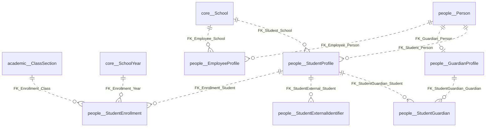

## security

7 جدولًا · 13 علاقة.

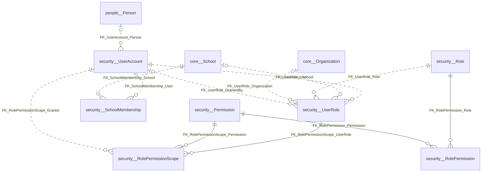

## transport

10 جدولًا · 24 علاقة.

```mermaid
erDiagram
    core__FileObject
    core__School
    people__EmployeeProfile
    people__StudentEnrollment
    security__UserAccount
    transport__RideNotice
    transport__Route
    transport__RouteRun
    transport__RouteStop
    transport__RunChaperone
    transport__StudentRide
    transport__TransportEnrollment
    transport__Vehicle
    transport__VehicleDocument
    transport__VehicleMaintenance
    transport__TransportEnrollment ||..o{ transport__RideNotice : "FK_RideNotice_Enrollment"
    security__UserAccount ||..o{ transport__RideNotice : "FK_RideNotice_User"
    core__School ||..o{ transport__Route : "FK_Route_School"
    people__EmployeeProfile ||..o{ transport__RouteRun : "FK_RouteRun_Driver"
    transport__Route ||..o{ transport__RouteRun : "FK_RouteRun_Route"
    transport__Vehicle ||..o{ transport__RouteRun : "FK_RouteRun_Vehicle"
    transport__Route ||..o{ transport__RouteStop : "FK_RouteStop_Route"
    people__EmployeeProfile ||..o{ transport__RunChaperone : "FK_RunChaperone_Employee"
    transport__RouteRun ||..o{ transport__RunChaperone : "FK_RunChaperone_Run"
    core__School ||..o{ transport__RunChaperone : "FK_RunChaperone_School"
    transport__TransportEnrollment ||..o{ transport__StudentRide : "FK_StudentRide_Enrollment"
    security__UserAccount ||..o{ transport__StudentRide : "FK_StudentRide_Recorder"
    transport__RouteRun ||..o{ transport__StudentRide : "FK_StudentRide_Run"
    core__School ||..o{ transport__StudentRide : "FK_StudentRide_School"
    transport__RouteStop ||..o{ transport__TransportEnrollment : "FK_TransportEnrollment_Dropoff"
    transport__RouteStop ||..o{ transport__TransportEnrollment : "FK_TransportEnrollment_Pickup"
    transport__Route ||..o{ transport__TransportEnrollment : "FK_TransportEnrollment_Route"
    people__StudentEnrollment ||..o{ transport__TransportEnrollment : "FK_TransportEnrollment_Student"
    core__School ||..o{ transport__Vehicle : "FK_Vehicle_School"
    core__FileObject ||..o{ transport__VehicleDocument : "FK_VehicleDocument_File"
    core__School ||..o{ transport__VehicleDocument : "FK_VehicleDocument_School"
    transport__Vehicle ||..o{ transport__VehicleDocument : "FK_VehicleDocument_Vehicle"
    core__School ||..o{ transport__VehicleMaintenance : "FK_VehicleMaintenance_School"
    transport__Vehicle ||..o{ transport__VehicleMaintenance : "FK_VehicleMaintenance_Vehicle"
```
