# سكيما قاعدة بيانات عون — Schema Diagram

الجداول والأعمدة وأنواع SQL Server والمفاتيح، مقسمة حسب القسم لتسهيل العرض على GitHub.

[مخطط العلاقات ERD](ER-Diagram.md) · [أوامر إنشاء قاعدة البيانات SQL](queries.sql)

`PK` مفتاح أساسي، `FK` عمود ضمن مفتاح أجنبي، `UK` مفتاح فريد على عمود واحد دون شرط. الفهارس الفريدة المركبة والقيود الكاملة موجودة في ملفات SQL.

تعرض جداول القسم جميع أعمدتها. وتظهر الجداول المرجعية من الأقسام الأخرى بأعمدة المفتاح الأساسي والأعمدة المشار إليها فقط. نوع العمود التفصيلي وقابلية NULL موضحان في التعليق.

## academic

```mermaid
erDiagram
    academic__Building {
        uniqueidentifier BuildingId PK,UK "uniqueidentifier; NOT NULL"
        uniqueidentifier SchoolId FK "uniqueidentifier; NOT NULL"
        nvarchar Code "nvarchar(40); NOT NULL"
        nvarchar Name "nvarchar(120); NOT NULL"
        varchar Status "varchar(20); NOT NULL"
    }
    academic__ClassSection {
        uniqueidentifier ClassSectionId PK,UK "uniqueidentifier; NOT NULL"
        uniqueidentifier SchoolId FK "uniqueidentifier; NOT NULL"
        uniqueidentifier SchoolYearId FK "uniqueidentifier; NOT NULL"
        uniqueidentifier GradeLevelId FK "uniqueidentifier; NOT NULL"
        nvarchar Code "nvarchar(40); NOT NULL"
        nvarchar Name "nvarchar(120); NOT NULL"
        smallint Capacity "smallint; NULL"
        varchar Status "varchar(20); NOT NULL"
        timestamp RowVersion "timestamp; NOT NULL"
    }
    academic__CurriculumProgram {
        uniqueidentifier CurriculumProgramId PK,UK "uniqueidentifier; NOT NULL"
        uniqueidentifier SchoolId FK "uniqueidentifier; NOT NULL"
        nvarchar Code "nvarchar(50); NOT NULL"
        nvarchar Name "nvarchar(160); NOT NULL"
    }
    academic__GradeLevel {
        uniqueidentifier GradeLevelId PK,UK "uniqueidentifier; NOT NULL"
        uniqueidentifier SchoolId FK "uniqueidentifier; NOT NULL"
        uniqueidentifier StageId FK "uniqueidentifier; NOT NULL"
        nvarchar Code "nvarchar(40); NOT NULL"
        nvarchar Name "nvarchar(120); NOT NULL"
        smallint SortOrder "smallint; NOT NULL"
        varchar Status "varchar(20); NOT NULL"
        timestamp RowVersion "timestamp; NOT NULL"
    }
    academic__PeriodDefinition {
        uniqueidentifier PeriodId PK,UK "uniqueidentifier; NOT NULL"
        uniqueidentifier SchoolId FK "uniqueidentifier; NOT NULL"
        nvarchar Code "nvarchar(30); NOT NULL"
        nvarchar Name "nvarchar(80); NOT NULL"
        smallint SequenceNo "smallint; NOT NULL"
        time StartTime "time(0); NOT NULL"
        time EndTime "time(0); NOT NULL"
        varchar Status "varchar(20); NOT NULL"
    }
    academic__ProgramGrade {
        uniqueidentifier ProgramGradeId PK,UK "uniqueidentifier; NOT NULL"
        uniqueidentifier SchoolId FK "uniqueidentifier; NOT NULL"
        uniqueidentifier CurriculumProgramId FK "uniqueidentifier; NOT NULL"
        uniqueidentifier GradeLevelId FK "uniqueidentifier; NOT NULL"
    }
    academic__Room {
        uniqueidentifier RoomId PK,UK "uniqueidentifier; NOT NULL"
        uniqueidentifier SchoolId FK "uniqueidentifier; NOT NULL"
        uniqueidentifier BuildingId FK "uniqueidentifier; NULL"
        nvarchar Code "nvarchar(40); NOT NULL"
        nvarchar Name "nvarchar(120); NOT NULL"
        smallint Capacity "smallint; NULL"
        varchar Status "varchar(20); NOT NULL"
    }
    academic__Stage {
        uniqueidentifier StageId PK,UK "uniqueidentifier; NOT NULL"
        uniqueidentifier SchoolId FK "uniqueidentifier; NOT NULL"
        nvarchar Code "nvarchar(40); NOT NULL"
        nvarchar Name "nvarchar(120); NOT NULL"
        smallint SortOrder "smallint; NOT NULL"
        varchar Status "varchar(20); NOT NULL"
        timestamp RowVersion "timestamp; NOT NULL"
    }
    academic__Subject {
        uniqueidentifier SubjectId PK,UK "uniqueidentifier; NOT NULL"
        uniqueidentifier SchoolId FK "uniqueidentifier; NOT NULL"
        uniqueidentifier StageId FK "uniqueidentifier; NULL"
        nvarchar Code "nvarchar(40); NOT NULL"
        nvarchar Name "nvarchar(160); NOT NULL"
        varchar Status "varchar(20); NOT NULL"
        timestamp RowVersion "timestamp; NOT NULL"
    }
    academic__SupervisionScope {
        uniqueidentifier SupervisionScopeId PK,UK "uniqueidentifier; NOT NULL"
        uniqueidentifier SchoolId FK "uniqueidentifier; NOT NULL"
        uniqueidentifier SupervisorUserId FK "uniqueidentifier; NOT NULL"
        uniqueidentifier EmployeeId FK "uniqueidentifier; NULL"
        uniqueidentifier SubjectId FK "uniqueidentifier; NULL"
        date ValidFrom "date; NOT NULL"
        date ValidTo "date; NULL"
        varchar Status "varchar(20); NOT NULL"
        uniqueidentifier CreatedByUserId FK "uniqueidentifier; NOT NULL"
        timestamp RowVersion "timestamp; NOT NULL"
    }
    academic__TeachingAssignment {
        uniqueidentifier TeachingAssignmentId PK,UK "uniqueidentifier; NOT NULL"
        uniqueidentifier SchoolId FK "uniqueidentifier; NOT NULL"
        uniqueidentifier SchoolYearId FK "uniqueidentifier; NOT NULL"
        uniqueidentifier TermId FK "uniqueidentifier; NOT NULL"
        uniqueidentifier EmployeeId FK "uniqueidentifier; NOT NULL"
        uniqueidentifier SubjectId FK "uniqueidentifier; NOT NULL"
        uniqueidentifier ClassSectionId FK "uniqueidentifier; NOT NULL"
        varchar Status "varchar(20); NOT NULL"
        datetime2 CreatedAtUtc "datetime2(3); NOT NULL"
        timestamp RowVersion "timestamp; NOT NULL"
    }
    academic__TimetableLesson {
        uniqueidentifier TimetableLessonId PK,UK "uniqueidentifier; NOT NULL"
        uniqueidentifier SchoolId FK "uniqueidentifier; NOT NULL"
        uniqueidentifier SchoolYearId FK "uniqueidentifier; NOT NULL"
        uniqueidentifier TermId FK "uniqueidentifier; NOT NULL"
        uniqueidentifier TeachingAssignmentId FK "uniqueidentifier; NOT NULL"
        tinyint DayOfWeek "tinyint; NOT NULL"
        uniqueidentifier PeriodId FK "uniqueidentifier; NOT NULL"
        uniqueidentifier RoomId FK "uniqueidentifier; NULL"
        date EffectiveFrom "date; NOT NULL"
        date EffectiveTo "date; NULL"
        varchar Status "varchar(20); NOT NULL"
    }
    core__AcademicTerm {
        uniqueidentifier TermId PK,UK "uniqueidentifier; NOT NULL; external reference"
        uniqueidentifier SchoolId FK "uniqueidentifier; NOT NULL; external reference"
        uniqueidentifier SchoolYearId FK "uniqueidentifier; NOT NULL; external reference"
    }
    core__School {
        uniqueidentifier SchoolId PK,UK "uniqueidentifier; NOT NULL; external reference"
    }
    core__SchoolYear {
        uniqueidentifier SchoolYearId PK,UK "uniqueidentifier; NOT NULL; external reference"
        uniqueidentifier SchoolId FK "uniqueidentifier; NOT NULL; external reference"
    }
    people__EmployeeProfile {
        uniqueidentifier EmployeeId PK,UK "uniqueidentifier; NOT NULL; external reference"
        uniqueidentifier SchoolId FK "uniqueidentifier; NOT NULL; external reference"
    }
    security__UserAccount {
        uniqueidentifier UserId PK,UK "uniqueidentifier; NOT NULL; external reference"
    }
    core__School ||..o{ academic__Building : "FK_Building_School"
    academic__GradeLevel ||..o{ academic__ClassSection : "FK_ClassSection_Grade"
    core__SchoolYear ||..o{ academic__ClassSection : "FK_ClassSection_Year"
    core__School ||..o{ academic__CurriculumProgram : "FK_CurriculumProgram_School"
    core__School ||..o{ academic__GradeLevel : "FK_GradeLevel_School"
    academic__Stage ||..o{ academic__GradeLevel : "FK_GradeLevel_Stage"
    core__School ||..o{ academic__PeriodDefinition : "FK_Period_School"
    academic__GradeLevel ||..o{ academic__ProgramGrade : "FK_ProgramGrade_Grade"
    academic__CurriculumProgram ||..o{ academic__ProgramGrade : "FK_ProgramGrade_Program"
    core__School ||..o{ academic__ProgramGrade : "FK_ProgramGrade_School"
    academic__Building |o..o{ academic__Room : "FK_Room_Building"
    core__School ||..o{ academic__Room : "FK_Room_School"
    core__School ||..o{ academic__Stage : "FK_Stage_School"
    core__School ||..o{ academic__Subject : "FK_Subject_School"
    academic__Stage |o..o{ academic__Subject : "FK_Subject_Stage"
    security__UserAccount ||..o{ academic__SupervisionScope : "FK_SupervisionScope_Actor"
    people__EmployeeProfile |o..o{ academic__SupervisionScope : "FK_SupervisionScope_Employee"
    core__School ||..o{ academic__SupervisionScope : "FK_SupervisionScope_School"
    academic__Subject |o..o{ academic__SupervisionScope : "FK_SupervisionScope_Subject"
    security__UserAccount ||..o{ academic__SupervisionScope : "FK_SupervisionScope_User"
    academic__ClassSection ||..o{ academic__TeachingAssignment : "FK_TeachingAssignment_Class"
    people__EmployeeProfile ||..o{ academic__TeachingAssignment : "FK_TeachingAssignment_Employee"
    academic__Subject ||..o{ academic__TeachingAssignment : "FK_TeachingAssignment_Subject"
    core__AcademicTerm ||..o{ academic__TeachingAssignment : "FK_TeachingAssignment_Term"
    core__SchoolYear ||..o{ academic__TeachingAssignment : "FK_TeachingAssignment_Year"
    academic__TeachingAssignment ||..o{ academic__TimetableLesson : "FK_TimetableLesson_Assignment"
    academic__TeachingAssignment ||..o{ academic__TimetableLesson : "FK_TimetableLesson_AssignmentTerm"
    academic__PeriodDefinition ||..o{ academic__TimetableLesson : "FK_TimetableLesson_Period"
    academic__Room |o..o{ academic__TimetableLesson : "FK_TimetableLesson_Room"
```

## admissions

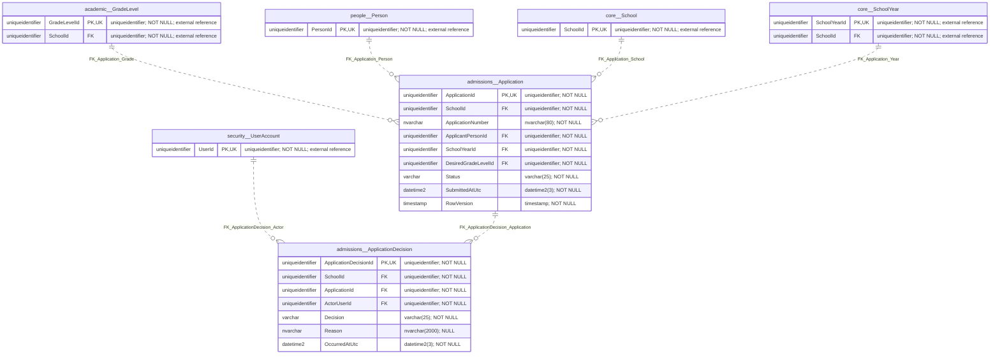

## assessment

```mermaid
erDiagram
    academic__GradeLevel {
        uniqueidentifier GradeLevelId PK,UK "uniqueidentifier; NOT NULL; external reference"
        uniqueidentifier SchoolId FK "uniqueidentifier; NOT NULL; external reference"
    }
    academic__Stage {
        uniqueidentifier StageId PK,UK "uniqueidentifier; NOT NULL; external reference"
        uniqueidentifier SchoolId FK "uniqueidentifier; NOT NULL; external reference"
    }
    academic__Subject {
        uniqueidentifier SubjectId PK,UK "uniqueidentifier; NOT NULL; external reference"
        uniqueidentifier SchoolId FK "uniqueidentifier; NOT NULL; external reference"
    }
    academic__TeachingAssignment {
        uniqueidentifier TeachingAssignmentId PK,UK "uniqueidentifier; NOT NULL; external reference"
        uniqueidentifier SchoolId FK "uniqueidentifier; NOT NULL; external reference"
    }
    assessment__Certificate {
        uniqueidentifier CertificateId PK,UK "uniqueidentifier; NOT NULL"
        uniqueidentifier SchoolId FK "uniqueidentifier; NOT NULL"
        uniqueidentifier GradePublicationId FK "uniqueidentifier; NOT NULL"
        uniqueidentifier EnrollmentId FK "uniqueidentifier; NOT NULL"
        nvarchar Serial "nvarchar(100); NOT NULL"
        binary VerificationTokenHash UK "binary(32); NOT NULL"
        datetime2 IssuedAtUtc "datetime2(3); NOT NULL"
        datetime2 RevokedAtUtc "datetime2(3); NULL"
        nvarchar RevocationReason "nvarchar(1000); NULL"
        nvarchar EncryptedToken "nvarchar(2000); NULL"
    }
    assessment__Exam {
        uniqueidentifier ExamId PK,UK "uniqueidentifier; NOT NULL"
        uniqueidentifier SchoolId FK "uniqueidentifier; NOT NULL"
        uniqueidentifier TeachingAssignmentId FK "uniqueidentifier; NOT NULL"
        nvarchar Title "nvarchar(200); NOT NULL"
        datetime2 OpensAtUtc "datetime2(3); NOT NULL"
        datetime2 ClosesAtUtc "datetime2(3); NOT NULL"
        smallint DurationMinutes "smallint; NOT NULL"
        smallint MaximumAttempts "smallint; NOT NULL"
        varchar Status "varchar(20); NOT NULL"
        varchar ReviewStatus "varchar(20); NOT NULL"
        int ReviewCycle "int; NOT NULL"
        date OpensOnSchoolDate "date; NULL"
        datetime2 ResultsReleasedAtUtc "datetime2(3); NULL"
        timestamp Revision "timestamp; NOT NULL"
    }
    assessment__ExamAttempt {
        uniqueidentifier ExamAttemptId PK,UK "uniqueidentifier; NOT NULL"
        uniqueidentifier SchoolId FK "uniqueidentifier; NOT NULL"
        uniqueidentifier ExamId FK "uniqueidentifier; NOT NULL"
        uniqueidentifier EnrollmentId FK "uniqueidentifier; NOT NULL"
        smallint AttemptNo "smallint; NOT NULL"
        datetime2 StartedAtUtc "datetime2(3); NOT NULL"
        datetime2 SubmittedAtUtc "datetime2(3); NULL"
        varchar Status "varchar(20); NOT NULL"
        datetime2 DeadlineAtUtc "datetime2(3); NULL"
        datetime2 GradedAtUtc "datetime2(3); NULL"
        timestamp Revision "timestamp; NOT NULL"
    }
    assessment__ExamQuestion {
        uniqueidentifier ExamQuestionId PK,UK "uniqueidentifier; NOT NULL"
        uniqueidentifier SchoolId FK "uniqueidentifier; NOT NULL"
        uniqueidentifier ExamId FK "uniqueidentifier; NOT NULL"
        uniqueidentifier QuestionId FK "uniqueidentifier; NOT NULL"
        decimal MaximumScore "decimal(9,4); NOT NULL"
        smallint SortOrder "smallint; NOT NULL"
    }
    assessment__ExamResponse {
        uniqueidentifier ExamResponseId PK,UK "uniqueidentifier; NOT NULL"
        uniqueidentifier SchoolId FK "uniqueidentifier; NOT NULL"
        uniqueidentifier ExamAttemptId FK "uniqueidentifier; NOT NULL"
        uniqueidentifier ExamId FK "uniqueidentifier; NOT NULL"
        uniqueidentifier ExamQuestionId FK "uniqueidentifier; NOT NULL"
        nvarchar AnswerJson "nvarchar(max); NOT NULL"
        decimal Score "decimal(9,4); NULL"
        nvarchar Feedback "nvarchar(2000); NULL"
    }
    assessment__ExamResponseRevision {
        uniqueidentifier ExamResponseRevisionId PK,UK "uniqueidentifier; NOT NULL"
        uniqueidentifier SchoolId FK "uniqueidentifier; NOT NULL"
        uniqueidentifier ExamResponseId FK "uniqueidentifier; NOT NULL"
        decimal Score "decimal(9,4); NOT NULL"
        nvarchar Feedback "nvarchar(2000); NULL"
        uniqueidentifier GradedByUserId FK "uniqueidentifier; NOT NULL"
        datetime2 CreatedAtUtc "datetime2(3); NOT NULL"
    }
    assessment__ExamReview {
        uniqueidentifier ExamReviewId PK,UK "uniqueidentifier; NOT NULL"
        uniqueidentifier SchoolId FK "uniqueidentifier; NOT NULL"
        uniqueidentifier ExamId FK "uniqueidentifier; NOT NULL"
        int ReviewCycle "int; NOT NULL"
        varchar Decision "varchar(20); NOT NULL"
        nvarchar Comments "nvarchar(3000); NOT NULL"
        uniqueidentifier ReviewedByUserId FK "uniqueidentifier; NOT NULL"
        datetime2 ReviewedAtUtc "datetime2(3); NOT NULL"
    }
    assessment__GradeItem {
        uniqueidentifier GradeItemId PK,UK "uniqueidentifier; NOT NULL"
        uniqueidentifier SchoolId FK "uniqueidentifier; NOT NULL"
        uniqueidentifier GradebookId FK "uniqueidentifier; NOT NULL"
        uniqueidentifier GradingComponentId FK "uniqueidentifier; NOT NULL"
        uniqueidentifier EnrollmentId FK "uniqueidentifier; NOT NULL"
        decimal Score "decimal(9,4); NULL"
        nvarchar DescriptiveLevel "nvarchar(100); NULL"
        nvarchar Feedback "nvarchar(2000); NULL"
        uniqueidentifier UpdatedByUserId FK "uniqueidentifier; NOT NULL"
        datetime2 UpdatedAtUtc "datetime2(3); NOT NULL"
        timestamp RowVersion "timestamp; NOT NULL"
    }
    assessment__GradeItemRevision {
        uniqueidentifier GradeItemRevisionId PK,UK "uniqueidentifier; NOT NULL"
        uniqueidentifier SchoolId FK "uniqueidentifier; NOT NULL"
        uniqueidentifier GradebookId FK "uniqueidentifier; NOT NULL"
        uniqueidentifier EnrollmentId FK "uniqueidentifier; NOT NULL"
        uniqueidentifier GradingComponentId FK "uniqueidentifier; NOT NULL"
        decimal Score "decimal(9,4); NULL"
        nvarchar DescriptiveLevel "nvarchar(100); NULL"
        nvarchar Feedback "nvarchar(2000); NULL"
        varchar ActionCode "varchar(10); NOT NULL"
        uniqueidentifier ActorUserId FK "uniqueidentifier; NOT NULL"
        datetime2 CreatedAtUtc "datetime2(3); NOT NULL"
    }
    assessment__GradePublication {
        uniqueidentifier GradePublicationId PK,UK "uniqueidentifier; NOT NULL"
        uniqueidentifier SchoolId FK "uniqueidentifier; NOT NULL"
        uniqueidentifier GradebookId FK "uniqueidentifier; NOT NULL"
        int VersionNo "int; NOT NULL"
        binary SnapshotHash "binary(32); NOT NULL"
        uniqueidentifier PublishedByUserId FK "uniqueidentifier; NOT NULL"
        datetime2 PublishedAtUtc "datetime2(3); NOT NULL"
        datetime2 RevokedAtUtc "datetime2(3); NULL"
        nvarchar RevocationReason "nvarchar(1000); NULL"
        datetime2 SealedAtUtc "datetime2(3); NULL"
    }
    assessment__Gradebook {
        uniqueidentifier GradebookId PK,UK "uniqueidentifier; NOT NULL"
        uniqueidentifier SchoolId FK "uniqueidentifier; NOT NULL"
        uniqueidentifier TeachingAssignmentId FK "uniqueidentifier; NOT NULL"
        uniqueidentifier GradingPolicyId FK "uniqueidentifier; NOT NULL"
        varchar Status "varchar(20); NOT NULL"
        int Revision "int; NOT NULL"
        datetime2 LockedAtUtc "datetime2(3); NULL"
        uniqueidentifier CreatedByUserId FK "uniqueidentifier; NOT NULL"
        datetime2 CreatedAtUtc "datetime2(3); NOT NULL"
        timestamp RowVersion "timestamp; NOT NULL"
    }
    assessment__GradebookEnrollment {
        uniqueidentifier SchoolId PK,FK "uniqueidentifier; NOT NULL"
        uniqueidentifier GradebookId PK,FK "uniqueidentifier; NOT NULL"
        uniqueidentifier EnrollmentId PK,FK "uniqueidentifier; NOT NULL"
        nvarchar StudentName "nvarchar(300); NOT NULL"
        nvarchar StudentCode "nvarchar(80); NOT NULL"
    }
    assessment__GradebookWorkflowEvent {
        bigint WorkflowEventId PK,UK "bigint; NOT NULL"
        uniqueidentifier SchoolId FK "uniqueidentifier; NOT NULL"
        uniqueidentifier GradebookId FK "uniqueidentifier; NOT NULL"
        uniqueidentifier ActorUserId FK "uniqueidentifier; NOT NULL"
        varchar FromStatus "varchar(30); NULL"
        varchar ToStatus "varchar(30); NOT NULL"
        nvarchar Note "nvarchar(2000); NULL"
        int Revision "int; NOT NULL"
        datetime2 OccurredAtUtc "datetime2(3); NOT NULL"
    }
    assessment__GradingComponent {
        uniqueidentifier GradingComponentId PK,UK "uniqueidentifier; NOT NULL"
        uniqueidentifier SchoolId FK "uniqueidentifier; NOT NULL"
        uniqueidentifier GradingPolicyId FK "uniqueidentifier; NOT NULL"
        nvarchar Code "nvarchar(50); NOT NULL"
        nvarchar Name "nvarchar(160); NOT NULL"
        decimal MaximumScore "decimal(9,4); NULL"
        decimal WeightPercent "decimal(7,4); NULL"
        smallint SortOrder "smallint; NOT NULL"
        bit IsRequired "bit; NOT NULL"
    }
    assessment__GradingLevel {
        uniqueidentifier SchoolId PK,FK "uniqueidentifier; NOT NULL"
        uniqueidentifier GradingPolicyId PK,FK "uniqueidentifier; NOT NULL"
        nvarchar Name PK "nvarchar(100); NOT NULL"
        smallint SortOrder "smallint; NOT NULL"
    }
    assessment__GradingPolicy {
        uniqueidentifier GradingPolicyId PK,UK "uniqueidentifier; NOT NULL"
        uniqueidentifier SchoolId FK "uniqueidentifier; NOT NULL"
        uniqueidentifier SchoolYearId FK "uniqueidentifier; NOT NULL"
        uniqueidentifier TermId FK "uniqueidentifier; NOT NULL"
        uniqueidentifier StageId FK "uniqueidentifier; NOT NULL"
        uniqueidentifier GradeLevelId FK "uniqueidentifier; NULL"
        uniqueidentifier SubjectId FK "uniqueidentifier; NULL"
        nvarchar Code "nvarchar(50); NOT NULL"
        int VersionNo "int; NOT NULL"
        varchar AssessmentMode "varchar(20); NOT NULL"
        varchar RoundingRule "varchar(20); NOT NULL"
        varchar Status "varchar(20); NOT NULL"
        date EffectiveFrom "date; NOT NULL"
        date EffectiveTo "date; NULL"
        uniqueidentifier CreatedByUserId FK "uniqueidentifier; NOT NULL"
        datetime2 CreatedAtUtc "datetime2(3); NOT NULL"
        timestamp RowVersion "timestamp; NOT NULL"
        nvarchar Title "nvarchar(200); NOT NULL"
        decimal TotalMaximum "decimal(9,4); NULL"
        varchar ReviewStatus "varchar(20); NOT NULL"
    }
    assessment__PolicyReview {
        uniqueidentifier PolicyReviewId PK,UK "uniqueidentifier; NOT NULL"
        uniqueidentifier SchoolId FK "uniqueidentifier; NOT NULL"
        uniqueidentifier GradingPolicyId FK "uniqueidentifier; NOT NULL"
        varchar Decision "varchar(20); NOT NULL"
        nvarchar Note "nvarchar(2000); NOT NULL"
        uniqueidentifier ActorUserId FK "uniqueidentifier; NOT NULL"
        datetime2 CreatedAtUtc "datetime2(3); NOT NULL"
    }
    assessment__PublishedGrade {
        uniqueidentifier SchoolId PK,FK "uniqueidentifier; NOT NULL"
        uniqueidentifier GradePublicationId PK,FK "uniqueidentifier; NOT NULL"
        uniqueidentifier EnrollmentId PK,FK "uniqueidentifier; NOT NULL"
        decimal Score "decimal(9,4); NULL"
        decimal MaximumScore "decimal(9,4); NULL"
        nvarchar DescriptiveResult "nvarchar(500); NULL"
        nvarchar DetailsJson "nvarchar(max); NOT NULL"
    }
    assessment__Question {
        uniqueidentifier QuestionId PK,UK "uniqueidentifier; NOT NULL"
        uniqueidentifier SchoolId FK "uniqueidentifier; NOT NULL"
        uniqueidentifier SubjectId FK "uniqueidentifier; NOT NULL"
        nvarchar Code "nvarchar(80); NOT NULL"
        int VersionNo "int; NOT NULL"
        nvarchar Prompt "nvarchar(max); NOT NULL"
        varchar QuestionType "varchar(20); NOT NULL"
        tinyint BloomLevel "tinyint; NOT NULL"
        nvarchar AnswerKeyJson "nvarchar(max); NOT NULL"
        uniqueidentifier CreatedByUserId FK "uniqueidentifier; NOT NULL"
        datetime2 CreatedAtUtc "datetime2(3); NOT NULL"
        timestamp Revision "timestamp; NOT NULL"
    }
    assessment__QuestionOption {
        uniqueidentifier QuestionOptionId PK,UK "uniqueidentifier; NOT NULL"
        uniqueidentifier SchoolId FK "uniqueidentifier; NOT NULL"
        uniqueidentifier QuestionId FK "uniqueidentifier; NOT NULL"
        nvarchar Code "nvarchar(30); NOT NULL"
        nvarchar OptionText "nvarchar(2000); NOT NULL"
        smallint SortOrder "smallint; NOT NULL"
    }
    assessment__ReopenRequest {
        uniqueidentifier ReopenRequestId PK,UK "uniqueidentifier; NOT NULL"
        uniqueidentifier SchoolId FK "uniqueidentifier; NOT NULL"
        uniqueidentifier GradebookId FK "uniqueidentifier; NOT NULL"
        uniqueidentifier RequestedByUserId FK "uniqueidentifier; NOT NULL"
        nvarchar Reason "nvarchar(2000); NOT NULL"
        varchar Status "varchar(20); NOT NULL"
        uniqueidentifier DecidedByUserId FK "uniqueidentifier; NULL"
        nvarchar DecisionNote "nvarchar(2000); NULL"
        datetime2 RequestedAtUtc "datetime2(3); NOT NULL"
        datetime2 DecidedAtUtc "datetime2(3); NULL"
    }
    core__AcademicTerm {
        uniqueidentifier TermId PK,UK "uniqueidentifier; NOT NULL; external reference"
        uniqueidentifier SchoolId FK "uniqueidentifier; NOT NULL; external reference"
        uniqueidentifier SchoolYearId FK "uniqueidentifier; NOT NULL; external reference"
    }
    core__School {
        uniqueidentifier SchoolId PK,UK "uniqueidentifier; NOT NULL; external reference"
    }
    core__SchoolYear {
        uniqueidentifier SchoolYearId PK,UK "uniqueidentifier; NOT NULL; external reference"
        uniqueidentifier SchoolId FK "uniqueidentifier; NOT NULL; external reference"
    }
    people__StudentEnrollment {
        uniqueidentifier EnrollmentId PK,UK "uniqueidentifier; NOT NULL; external reference"
        uniqueidentifier SchoolId FK "uniqueidentifier; NOT NULL; external reference"
    }
    security__UserAccount {
        uniqueidentifier UserId PK,UK "uniqueidentifier; NOT NULL; external reference"
    }
    assessment__PublishedGrade ||..o{ assessment__Certificate : "FK_Certificate_Grade"
    core__School ||..o{ assessment__Exam : "FK_Exam_School"
    academic__TeachingAssignment ||..o{ assessment__Exam : "FK_Exam_Teaching"
    people__StudentEnrollment ||..o{ assessment__ExamAttempt : "FK_ExamAttempt_Enrollment"
    assessment__Exam ||..o{ assessment__ExamAttempt : "FK_ExamAttempt_Exam"
    core__School ||..o{ assessment__ExamAttempt : "FK_ExamAttempt_School"
    assessment__Exam ||..o{ assessment__ExamQuestion : "FK_ExamQuestion_Exam"
    assessment__Question ||..o{ assessment__ExamQuestion : "FK_ExamQuestion_Question"
    core__School ||..o{ assessment__ExamQuestion : "FK_ExamQuestion_School"
    assessment__ExamAttempt ||..o{ assessment__ExamResponse : "FK_ExamResponse_Attempt"
    assessment__ExamQuestion ||..o{ assessment__ExamResponse : "FK_ExamResponse_Question"
    core__School ||..o{ assessment__ExamResponse : "FK_ExamResponse_School"
    security__UserAccount ||..o{ assessment__ExamResponseRevision : "FK_ExamResponseRevision_Actor"
    assessment__ExamResponse ||..o{ assessment__ExamResponseRevision : "FK_ExamResponseRevision_Response"
    security__UserAccount ||..o{ assessment__ExamReview : "FK_ExamReview_Actor"
    assessment__Exam ||..o{ assessment__ExamReview : "FK_ExamReview_Exam"
    security__UserAccount ||..o{ assessment__Gradebook : "FK_Gradebook_Creator"
    assessment__GradingPolicy ||..o{ assessment__Gradebook : "FK_Gradebook_Policy"
    academic__TeachingAssignment ||..o{ assessment__Gradebook : "FK_Gradebook_Teaching"
    assessment__Gradebook ||--o{ assessment__GradebookEnrollment : "FK_GradebookEnrollment_Book"
    people__StudentEnrollment ||--o{ assessment__GradebookEnrollment : "FK_GradebookEnrollment_Enrollment"
    security__UserAccount ||..o{ assessment__GradebookWorkflowEvent : "FK_GradebookEvent_Actor"
    assessment__Gradebook ||..o{ assessment__GradebookWorkflowEvent : "FK_GradebookEvent_Gradebook"
    assessment__GradingComponent ||..o{ assessment__GradeItem : "FK_GradeItem_Component"
    people__StudentEnrollment ||..o{ assessment__GradeItem : "FK_GradeItem_Enrollment"
    assessment__Gradebook ||..o{ assessment__GradeItem : "FK_GradeItem_Gradebook"
    assessment__GradebookEnrollment ||..o{ assessment__GradeItem : "FK_GradeItem_Roster"
    security__UserAccount ||..o{ assessment__GradeItem : "FK_GradeItem_Updater"
    security__UserAccount ||..o{ assessment__GradeItemRevision : "FK_GradeItemRevision_Actor"
    assessment__Gradebook ||..o{ assessment__GradeItemRevision : "FK_GradeItemRevision_Book"
    assessment__GradingComponent ||..o{ assessment__GradeItemRevision : "FK_GradeItemRevision_Component"
    people__StudentEnrollment ||..o{ assessment__GradeItemRevision : "FK_GradeItemRevision_Enrollment"
    assessment__Gradebook ||..o{ assessment__GradePublication : "FK_GradePublication_Gradebook"
    security__UserAccount ||..o{ assessment__GradePublication : "FK_GradePublication_Publisher"
    assessment__GradingPolicy ||..o{ assessment__GradingComponent : "FK_GradingComponent_Policy"
    assessment__GradingPolicy ||--o{ assessment__GradingLevel : "FK_GradingLevel_Policy"
    security__UserAccount ||..o{ assessment__GradingPolicy : "FK_GradingPolicy_Author"
    academic__GradeLevel |o..o{ assessment__GradingPolicy : "FK_GradingPolicy_Grade"
    academic__Stage ||..o{ assessment__GradingPolicy : "FK_GradingPolicy_Stage"
    academic__Subject |o..o{ assessment__GradingPolicy : "FK_GradingPolicy_Subject"
    core__AcademicTerm ||..o{ assessment__GradingPolicy : "FK_GradingPolicy_Term"
    core__SchoolYear ||..o{ assessment__GradingPolicy : "FK_GradingPolicy_Year"
    security__UserAccount ||..o{ assessment__PolicyReview : "FK_PolicyReview_Actor"
    assessment__GradingPolicy ||..o{ assessment__PolicyReview : "FK_PolicyReview_Policy"
    people__StudentEnrollment ||--o{ assessment__PublishedGrade : "FK_PublishedGrade_Enrollment"
    assessment__GradePublication ||--o{ assessment__PublishedGrade : "FK_PublishedGrade_Publication"
    security__UserAccount ||..o{ assessment__Question : "FK_Question_Author"
    core__School ||..o{ assessment__Question : "FK_Question_School"
    academic__Subject ||..o{ assessment__Question : "FK_Question_Subject"
    assessment__Question ||..o{ assessment__QuestionOption : "FK_QuestionOption_Question"
    core__School ||..o{ assessment__QuestionOption : "FK_QuestionOption_School"
    security__UserAccount |o..o{ assessment__ReopenRequest : "FK_ReopenRequest_Decider"
    assessment__Gradebook ||..o{ assessment__ReopenRequest : "FK_ReopenRequest_Gradebook"
    security__UserAccount ||..o{ assessment__ReopenRequest : "FK_ReopenRequest_Requester"
```

## attendance

```mermaid
erDiagram
    academic__ClassSection {
        uniqueidentifier ClassSectionId PK,UK "uniqueidentifier; NOT NULL; external reference"
        uniqueidentifier SchoolId FK "uniqueidentifier; NOT NULL; external reference"
    }
    academic__PeriodDefinition {
        uniqueidentifier PeriodId PK,UK "uniqueidentifier; NOT NULL; external reference"
        uniqueidentifier SchoolId FK "uniqueidentifier; NOT NULL; external reference"
    }
    academic__TimetableLesson {
        uniqueidentifier TimetableLessonId PK,UK "uniqueidentifier; NOT NULL; external reference"
        uniqueidentifier SchoolId FK "uniqueidentifier; NOT NULL; external reference"
    }
    attendance__AttendanceSession {
        uniqueidentifier AttendanceSessionId PK,UK "uniqueidentifier; NOT NULL"
        uniqueidentifier SchoolId FK "uniqueidentifier; NOT NULL"
        date SessionDate "date; NOT NULL"
        varchar SessionType "varchar(20); NOT NULL"
        uniqueidentifier ClassSectionId FK "uniqueidentifier; NULL"
        uniqueidentifier PeriodId FK "uniqueidentifier; NULL"
        uniqueidentifier TakenByUserId FK "uniqueidentifier; NOT NULL"
        varchar Status "varchar(20); NOT NULL"
        datetime2 SubmittedAtUtc "datetime2(3); NULL"
        datetime2 CreatedAtUtc "datetime2(3); NOT NULL"
        timestamp RowVersion "timestamp; NOT NULL"
        uniqueidentifier TimetableLessonId FK "uniqueidentifier; NULL"
    }
    attendance__CoverAssignment {
        uniqueidentifier CoverAssignmentId PK,UK "uniqueidentifier; NOT NULL"
        uniqueidentifier SchoolId FK "uniqueidentifier; NOT NULL"
        uniqueidentifier LeaveRequestId FK "uniqueidentifier; NOT NULL"
        uniqueidentifier TimetableLessonId FK "uniqueidentifier; NOT NULL"
        uniqueidentifier SubstituteEmployeeId FK "uniqueidentifier; NOT NULL"
        date CoverDate "date; NOT NULL"
        varchar Status "varchar(20); NOT NULL"
        nvarchar Reason "nvarchar(1000); NULL"
        uniqueidentifier AssignedByUserId FK "uniqueidentifier; NOT NULL"
        datetime2 CreatedAtUtc "datetime2(3); NOT NULL"
    }
    attendance__EmployeeAttendance {
        uniqueidentifier EmployeeAttendanceId PK,UK "uniqueidentifier; NOT NULL"
        uniqueidentifier SchoolId FK "uniqueidentifier; NOT NULL"
        uniqueidentifier EmployeeId FK "uniqueidentifier; NOT NULL"
        date WorkDate "date; NOT NULL"
        nvarchar ShiftCode "nvarchar(40); NOT NULL"
        varchar StatusCode "varchar(20); NOT NULL"
        datetime2 ClockInAtUtc "datetime2(3); NULL"
        datetime2 ClockOutAtUtc "datetime2(3); NULL"
        varchar Source "varchar(20); NOT NULL"
        uniqueidentifier RecordedByUserId FK "uniqueidentifier; NOT NULL"
        timestamp RowVersion "timestamp; NOT NULL"
    }
    attendance__LeaveDecision {
        uniqueidentifier LeaveDecisionId PK,UK "uniqueidentifier; NOT NULL"
        uniqueidentifier SchoolId FK "uniqueidentifier; NOT NULL"
        uniqueidentifier LeaveRequestId FK "uniqueidentifier; NOT NULL"
        uniqueidentifier ActorUserId FK "uniqueidentifier; NOT NULL"
        varchar Decision "varchar(20); NOT NULL"
        nvarchar Note "nvarchar(1000); NULL"
        datetime2 OccurredAtUtc "datetime2(3); NOT NULL"
    }
    attendance__LeaveEntitlement {
        uniqueidentifier LeaveEntitlementId PK,UK "uniqueidentifier; NOT NULL"
        uniqueidentifier SchoolId FK "uniqueidentifier; NOT NULL"
        uniqueidentifier EmployeeId FK "uniqueidentifier; NOT NULL"
        varchar LeaveTypeCode "varchar(40); NOT NULL"
        date PeriodStart "date; NOT NULL"
        date PeriodEnd "date; NOT NULL"
        decimal EntitledDays "decimal(7,2); NOT NULL"
    }
    attendance__LeaveRequest {
        uniqueidentifier LeaveRequestId PK,UK "uniqueidentifier; NOT NULL"
        uniqueidentifier SchoolId FK "uniqueidentifier; NOT NULL"
        uniqueidentifier EmployeeId FK "uniqueidentifier; NOT NULL"
        varchar LeaveTypeCode "varchar(40); NOT NULL"
        date StartDate "date; NOT NULL"
        date EndDate "date; NOT NULL"
        nvarchar Reason "nvarchar(2000); NOT NULL"
        uniqueidentifier AttachmentFileObjectId FK "uniqueidentifier; NULL"
        varchar Status "varchar(20); NOT NULL"
        datetime2 SubmittedAtUtc "datetime2(3); NOT NULL"
        timestamp RowVersion "timestamp; NOT NULL"
        time StartTimeLocal "time(0); NULL"
        time EndTimeLocal "time(0); NULL"
    }
    attendance__LeaveUsage {
        uniqueidentifier LeaveUsageId PK,UK "uniqueidentifier; NOT NULL"
        uniqueidentifier SchoolId FK "uniqueidentifier; NOT NULL"
        uniqueidentifier LeaveEntitlementId FK "uniqueidentifier; NOT NULL"
        uniqueidentifier LeaveRequestId FK "uniqueidentifier; NOT NULL"
        decimal DaysUsed "decimal(7,2); NOT NULL"
    }
    attendance__StudentAttendance {
        uniqueidentifier AttendanceSessionId PK,FK "uniqueidentifier; NOT NULL"
        uniqueidentifier SchoolId FK "uniqueidentifier; NOT NULL"
        uniqueidentifier EnrollmentId PK,FK "uniqueidentifier; NOT NULL"
        varchar StatusCode "varchar(20); NOT NULL"
        nvarchar Reason "nvarchar(500); NULL"
        varchar Source "varchar(20); NOT NULL"
        datetime2 RecordedAtUtc "datetime2(3); NOT NULL"
        uniqueidentifier RecordedByUserId FK "uniqueidentifier; NOT NULL"
    }
    core__FileObject {
        uniqueidentifier FileObjectId PK,UK "uniqueidentifier; NOT NULL; external reference"
        uniqueidentifier SchoolId FK "uniqueidentifier; NOT NULL; external reference"
    }
    core__School {
        uniqueidentifier SchoolId PK,UK "uniqueidentifier; NOT NULL; external reference"
    }
    people__EmployeeProfile {
        uniqueidentifier EmployeeId PK,UK "uniqueidentifier; NOT NULL; external reference"
        uniqueidentifier SchoolId FK "uniqueidentifier; NOT NULL; external reference"
    }
    people__StudentEnrollment {
        uniqueidentifier EnrollmentId PK,UK "uniqueidentifier; NOT NULL; external reference"
        uniqueidentifier SchoolId FK "uniqueidentifier; NOT NULL; external reference"
    }
    security__UserAccount {
        uniqueidentifier UserId PK,UK "uniqueidentifier; NOT NULL; external reference"
    }
    academic__ClassSection |o..o{ attendance__AttendanceSession : "FK_AttendanceSession_Class"
    academic__TimetableLesson |o..o{ attendance__AttendanceSession : "FK_AttendanceSession_Lesson"
    academic__PeriodDefinition |o..o{ attendance__AttendanceSession : "FK_AttendanceSession_Period"
    core__School ||..o{ attendance__AttendanceSession : "FK_AttendanceSession_School"
    security__UserAccount ||..o{ attendance__AttendanceSession : "FK_AttendanceSession_Taker"
    security__UserAccount ||..o{ attendance__CoverAssignment : "FK_Cover_Assigner"
    attendance__LeaveRequest ||..o{ attendance__CoverAssignment : "FK_Cover_Leave"
    academic__TimetableLesson ||..o{ attendance__CoverAssignment : "FK_Cover_Lesson"
    people__EmployeeProfile ||..o{ attendance__CoverAssignment : "FK_Cover_Substitute"
    people__EmployeeProfile ||..o{ attendance__EmployeeAttendance : "FK_EmployeeAttendance_Employee"
    security__UserAccount ||..o{ attendance__EmployeeAttendance : "FK_EmployeeAttendance_Recorder"
    security__UserAccount ||..o{ attendance__LeaveDecision : "FK_LeaveDecision_Actor"
    attendance__LeaveRequest ||..o{ attendance__LeaveDecision : "FK_LeaveDecision_Request"
    people__EmployeeProfile ||..o{ attendance__LeaveEntitlement : "FK_LeaveEntitlement_Employee"
    core__School ||..o{ attendance__LeaveEntitlement : "FK_LeaveEntitlement_School"
    people__EmployeeProfile ||..o{ attendance__LeaveRequest : "FK_LeaveRequest_Employee"
    core__FileObject |o..o{ attendance__LeaveRequest : "FK_LeaveRequest_File"
    attendance__LeaveEntitlement ||..o{ attendance__LeaveUsage : "FK_LeaveUsage_Entitlement"
    attendance__LeaveRequest ||..o| attendance__LeaveUsage : "FK_LeaveUsage_Request"
    core__School ||..o{ attendance__LeaveUsage : "FK_LeaveUsage_School"
    people__StudentEnrollment ||..o{ attendance__StudentAttendance : "FK_StudentAttendance_Enrollment"
    security__UserAccount ||..o{ attendance__StudentAttendance : "FK_StudentAttendance_Recorder"
    attendance__AttendanceSession ||..o{ attendance__StudentAttendance : "FK_StudentAttendance_Session"
```

## audit

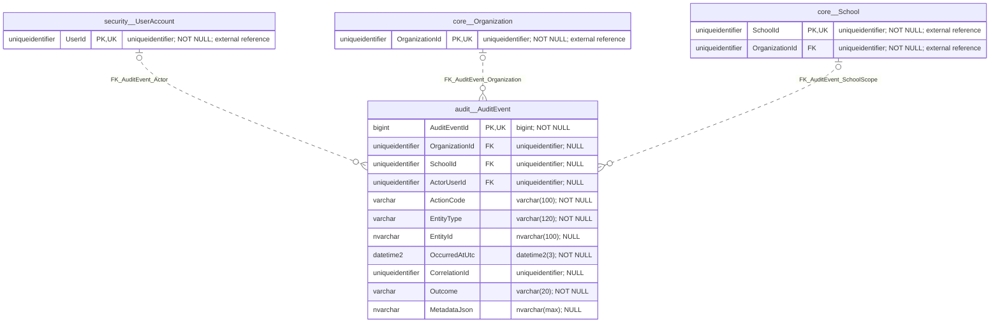

## core

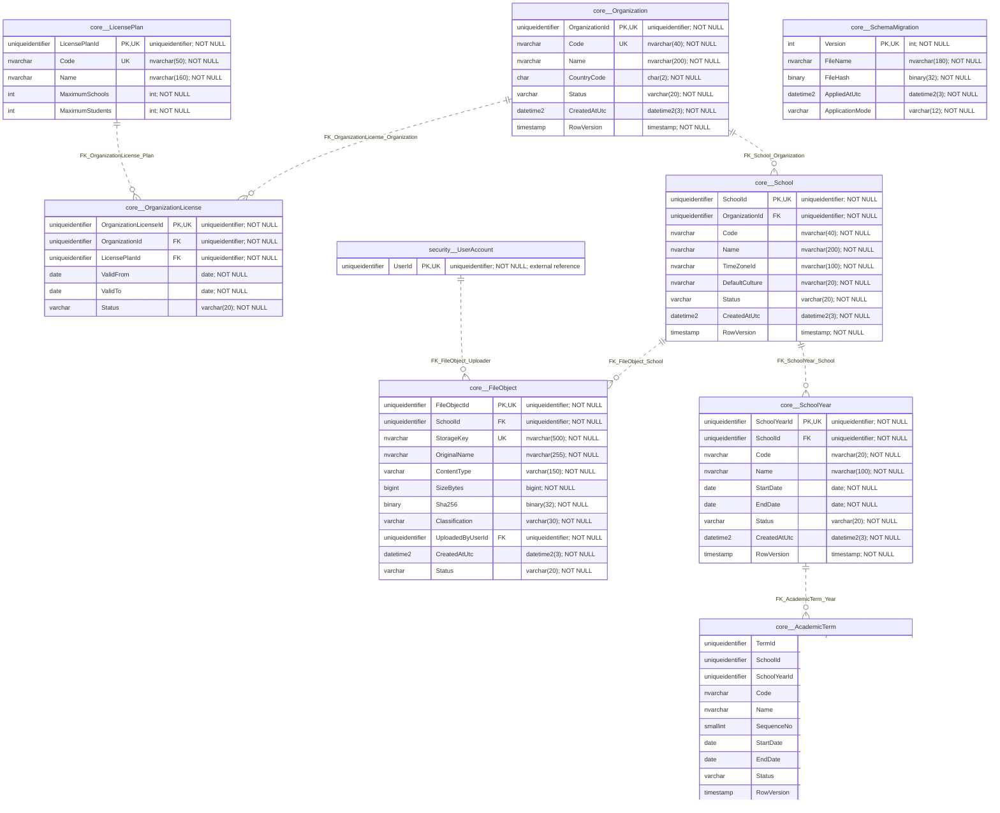

## finance

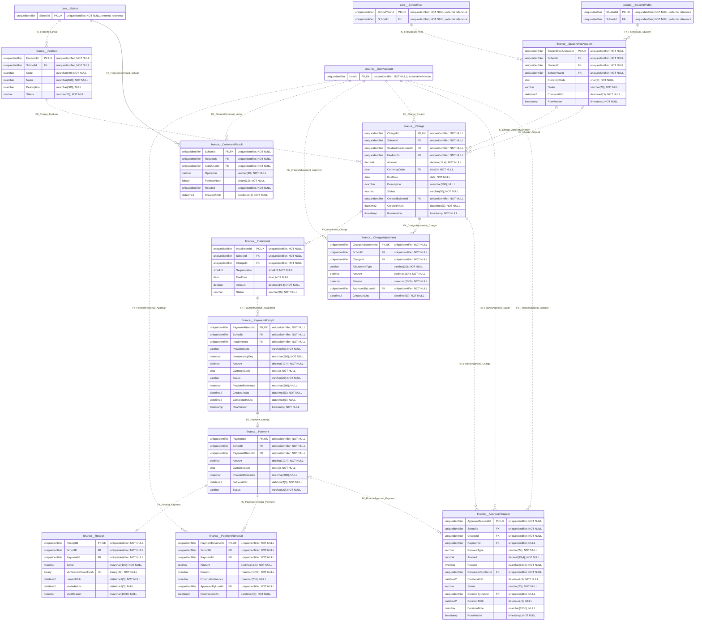

## health

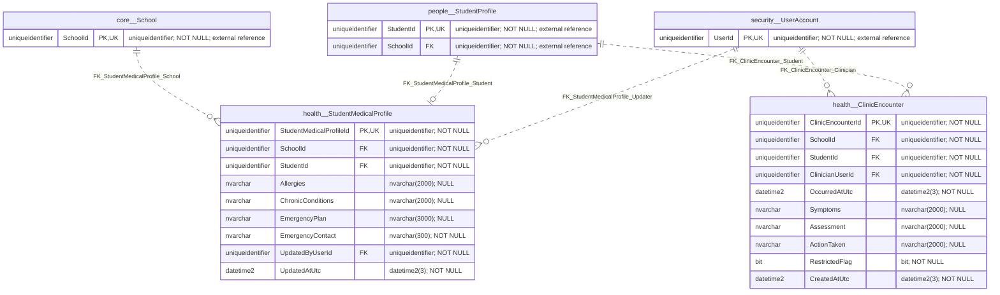

## hr

```mermaid
erDiagram
    core__FileObject {
        uniqueidentifier FileObjectId PK,UK "uniqueidentifier; NOT NULL; external reference"
        uniqueidentifier SchoolId FK "uniqueidentifier; NOT NULL; external reference"
    }
    core__School {
        uniqueidentifier SchoolId PK,UK "uniqueidentifier; NOT NULL; external reference"
    }
    hr__EmployeeSalaryComponent {
        uniqueidentifier EmployeeSalaryComponentId PK,UK "uniqueidentifier; NOT NULL"
        uniqueidentifier SchoolId FK "uniqueidentifier; NOT NULL"
        uniqueidentifier EmployeeId FK "uniqueidentifier; NOT NULL"
        uniqueidentifier SalaryComponentId FK "uniqueidentifier; NOT NULL"
        date EffectiveFrom "date; NOT NULL"
        date EffectiveTo "date; NULL"
        decimal Amount "decimal(19,4); NOT NULL"
        char CurrencyCode "char(3); NOT NULL"
    }
    hr__EmploymentContract {
        uniqueidentifier EmploymentContractId PK,UK "uniqueidentifier; NOT NULL"
        uniqueidentifier SchoolId FK "uniqueidentifier; NOT NULL"
        uniqueidentifier EmployeeId FK "uniqueidentifier; NOT NULL"
        nvarchar ContractNumber "nvarchar(80); NOT NULL"
        varchar ContractType "varchar(30); NOT NULL"
        date StartDate "date; NOT NULL"
        date EndDate "date; NULL"
        varchar Status "varchar(20); NOT NULL"
        uniqueidentifier DocumentFileObjectId FK "uniqueidentifier; NULL"
        timestamp RowVersion "timestamp; NOT NULL"
    }
    hr__PayrollRun {
        uniqueidentifier PayrollRunId PK,UK "uniqueidentifier; NOT NULL"
        uniqueidentifier SchoolId FK "uniqueidentifier; NOT NULL"
        date PeriodStart "date; NOT NULL"
        date PeriodEnd "date; NOT NULL"
        smallint RunNo "smallint; NOT NULL"
        char CurrencyCode "char(3); NOT NULL"
        varchar Status "varchar(20); NOT NULL"
        uniqueidentifier ApprovedByUserId FK "uniqueidentifier; NULL"
        datetime2 ApprovedAtUtc "datetime2(3); NULL"
        datetime2 CreatedAtUtc "datetime2(3); NOT NULL"
        timestamp RowVersion "timestamp; NOT NULL"
    }
    hr__PayrollRunLine {
        uniqueidentifier PayrollRunLineId PK,UK "uniqueidentifier; NOT NULL"
        uniqueidentifier SchoolId FK "uniqueidentifier; NOT NULL"
        uniqueidentifier PayrollRunId FK "uniqueidentifier; NOT NULL"
        uniqueidentifier EmployeeId FK "uniqueidentifier; NOT NULL"
        decimal GrossAmount "decimal(19,4); NOT NULL"
        decimal DeductionAmount "decimal(19,4); NOT NULL"
        decimal NetAmount "decimal(19,4); NOT NULL"
        char CurrencyCode "char(3); NOT NULL"
        nvarchar BreakdownJson "nvarchar(max); NOT NULL"
    }
    hr__SalaryComponent {
        uniqueidentifier SalaryComponentId PK,UK "uniqueidentifier; NOT NULL"
        uniqueidentifier SchoolId FK "uniqueidentifier; NOT NULL"
        nvarchar Code "nvarchar(50); NOT NULL"
        nvarchar Name "nvarchar(160); NOT NULL"
        varchar ComponentType "varchar(20); NOT NULL"
    }
    people__EmployeeProfile {
        uniqueidentifier EmployeeId PK,UK "uniqueidentifier; NOT NULL; external reference"
        uniqueidentifier SchoolId FK "uniqueidentifier; NOT NULL; external reference"
    }
    security__UserAccount {
        uniqueidentifier UserId PK,UK "uniqueidentifier; NOT NULL; external reference"
    }
    hr__SalaryComponent ||..o{ hr__EmployeeSalaryComponent : "FK_EmployeeSalaryComponent_Component"
    people__EmployeeProfile ||..o{ hr__EmployeeSalaryComponent : "FK_EmployeeSalaryComponent_Employee"
    core__School ||..o{ hr__EmployeeSalaryComponent : "FK_EmployeeSalaryComponent_School"
    people__EmployeeProfile ||..o{ hr__EmploymentContract : "FK_EmploymentContract_Employee"
    core__FileObject |o..o{ hr__EmploymentContract : "FK_EmploymentContract_File"
    security__UserAccount |o..o{ hr__PayrollRun : "FK_PayrollRun_Approver"
    core__School ||..o{ hr__PayrollRun : "FK_PayrollRun_School"
    people__EmployeeProfile ||..o{ hr__PayrollRunLine : "FK_PayrollLine_Employee"
    hr__PayrollRun ||..o{ hr__PayrollRunLine : "FK_PayrollLine_Run"
    core__School ||..o{ hr__SalaryComponent : "FK_SalaryComponent_School"
```

## learning

```mermaid
erDiagram
    academic__ClassSection {
        uniqueidentifier ClassSectionId PK,UK "uniqueidentifier; NOT NULL; external reference"
        uniqueidentifier SchoolId FK "uniqueidentifier; NOT NULL; external reference"
    }
    academic__GradeLevel {
        uniqueidentifier GradeLevelId PK,UK "uniqueidentifier; NOT NULL; external reference"
        uniqueidentifier SchoolId FK "uniqueidentifier; NOT NULL; external reference"
    }
    academic__Stage {
        uniqueidentifier StageId PK,UK "uniqueidentifier; NOT NULL; external reference"
        uniqueidentifier SchoolId FK "uniqueidentifier; NOT NULL; external reference"
    }
    academic__Subject {
        uniqueidentifier SubjectId PK,UK "uniqueidentifier; NOT NULL; external reference"
        uniqueidentifier SchoolId FK "uniqueidentifier; NOT NULL; external reference"
    }
    academic__TeachingAssignment {
        uniqueidentifier TeachingAssignmentId PK,UK "uniqueidentifier; NOT NULL; external reference"
        uniqueidentifier SchoolId FK "uniqueidentifier; NOT NULL; external reference"
    }
    core__FileObject {
        uniqueidentifier FileObjectId PK,UK "uniqueidentifier; NOT NULL; external reference"
        uniqueidentifier SchoolId FK "uniqueidentifier; NOT NULL; external reference"
    }
    core__School {
        uniqueidentifier SchoolId PK,UK "uniqueidentifier; NOT NULL; external reference"
    }
    learning__Assignment {
        uniqueidentifier AssignmentId PK,UK "uniqueidentifier; NOT NULL"
        uniqueidentifier SchoolId FK "uniqueidentifier; NOT NULL"
        uniqueidentifier TeachingAssignmentId FK "uniqueidentifier; NOT NULL"
        nvarchar Title "nvarchar(200); NOT NULL"
        nvarchar Instructions "nvarchar(max); NULL"
        datetime2 DueAtLocal "datetime2(0); NOT NULL"
        decimal MaximumScore "decimal(9,4); NOT NULL"
        varchar Status "varchar(20); NOT NULL"
        uniqueidentifier CreatedByUserId FK "uniqueidentifier; NOT NULL"
        datetime2 CreatedAtUtc "datetime2(3); NOT NULL"
        timestamp RowVersion "timestamp; NOT NULL"
        datetime2 DueAtUtc "datetime2(3); NOT NULL"
        date PublishedOnSchoolDate "date; NULL"
        bit AllowLate "bit; NOT NULL"
    }
    learning__AssignmentFile {
        uniqueidentifier AssignmentId PK,FK "uniqueidentifier; NOT NULL"
        uniqueidentifier SchoolId FK "uniqueidentifier; NOT NULL"
        uniqueidentifier FileObjectId PK,FK "uniqueidentifier; NOT NULL"
        smallint SortOrder "smallint; NOT NULL"
    }
    learning__Circular {
        uniqueidentifier CircularId PK,UK "uniqueidentifier; NOT NULL"
        uniqueidentifier SchoolId FK "uniqueidentifier; NOT NULL"
        nvarchar Title "nvarchar(200); NOT NULL"
        nvarchar Body "nvarchar(max); NOT NULL"
        int VersionNo "int; NOT NULL"
        varchar Status "varchar(20); NOT NULL"
        uniqueidentifier CreatedByUserId FK "uniqueidentifier; NOT NULL"
        datetime2 PublishedAtUtc "datetime2(3); NULL"
        date ExpiresOn "date; NULL"
        datetime2 CreatedAtUtc "datetime2(3); NOT NULL"
        timestamp RowVersion "timestamp; NOT NULL"
    }
    learning__CircularAcknowledgement {
        uniqueidentifier SchoolId PK,FK "uniqueidentifier; NOT NULL"
        uniqueidentifier CircularId PK,FK "uniqueidentifier; NOT NULL"
        uniqueidentifier UserId PK,FK "uniqueidentifier; NOT NULL"
        datetime2 AcknowledgedAtUtc "datetime2(3); NOT NULL"
    }
    learning__CircularAudience {
        uniqueidentifier CircularAudienceId PK,UK "uniqueidentifier; NOT NULL"
        uniqueidentifier SchoolId FK "uniqueidentifier; NOT NULL"
        uniqueidentifier CircularId FK "uniqueidentifier; NOT NULL"
        varchar AudienceType "varchar(20); NOT NULL"
        uniqueidentifier GradeLevelId FK "uniqueidentifier; NULL"
        uniqueidentifier ClassSectionId FK "uniqueidentifier; NULL"
        smallint RoleId FK "smallint; NULL"
    }
    learning__Conversation {
        uniqueidentifier ConversationId PK,UK "uniqueidentifier; NOT NULL"
        uniqueidentifier SchoolId FK "uniqueidentifier; NOT NULL"
        nvarchar Subject "nvarchar(200); NOT NULL"
        uniqueidentifier CreatedByUserId FK "uniqueidentifier; NOT NULL"
        datetime2 CreatedAtUtc "datetime2(3); NOT NULL"
    }
    learning__ConversationMember {
        uniqueidentifier ConversationMemberId PK,UK "uniqueidentifier; NOT NULL"
        uniqueidentifier SchoolId FK "uniqueidentifier; NOT NULL"
        uniqueidentifier ConversationId FK "uniqueidentifier; NOT NULL"
        uniqueidentifier UserId FK "uniqueidentifier; NOT NULL"
        datetime2 JoinedAtUtc "datetime2(3); NOT NULL"
        datetime2 LeftAtUtc "datetime2(3); NULL"
    }
    learning__Message {
        uniqueidentifier MessageId PK,UK "uniqueidentifier; NOT NULL"
        uniqueidentifier SchoolId FK "uniqueidentifier; NOT NULL"
        uniqueidentifier ConversationId FK "uniqueidentifier; NOT NULL"
        uniqueidentifier SenderUserId FK "uniqueidentifier; NOT NULL"
        nvarchar Body "nvarchar(max); NOT NULL"
        datetime2 SentAtUtc "datetime2(3); NOT NULL"
        uniqueidentifier AttachmentFileObjectId FK "uniqueidentifier; NULL"
    }
    learning__Notification {
        uniqueidentifier NotificationId PK,UK "uniqueidentifier; NOT NULL"
        uniqueidentifier SchoolId FK "uniqueidentifier; NOT NULL"
        uniqueidentifier RecipientUserId FK "uniqueidentifier; NOT NULL"
        nvarchar Title "nvarchar(200); NOT NULL"
        nvarchar Body "nvarchar(2000); NOT NULL"
        datetime2 CreatedAtUtc "datetime2(3); NOT NULL"
        datetime2 ReadAtUtc "datetime2(3); NULL"
    }
    learning__Plan {
        uniqueidentifier PlanId PK,UK "uniqueidentifier; NOT NULL"
        uniqueidentifier SchoolId FK "uniqueidentifier; NOT NULL"
        uniqueidentifier TeachingAssignmentId FK "uniqueidentifier; NOT NULL"
        varchar PlanType "varchar(20); NOT NULL"
        nvarchar Title "nvarchar(200); NOT NULL"
        varchar Status "varchar(20); NOT NULL"
        int CurrentVersionNo "int; NOT NULL"
        datetime2 CreatedAtUtc "datetime2(3); NOT NULL"
        timestamp RowVersion "timestamp; NOT NULL"
    }
    learning__PlanProgress {
        uniqueidentifier SchoolId PK,FK "uniqueidentifier; NOT NULL"
        uniqueidentifier PlanId PK,FK "uniqueidentifier; NOT NULL"
        int CompletedUnits "int; NOT NULL"
        int TotalUnits "int; NOT NULL"
        nvarchar Note "nvarchar(1000); NOT NULL"
        uniqueidentifier RecordedByUserId FK "uniqueidentifier; NOT NULL"
        datetime2 RecordedAtUtc "datetime2(3); NOT NULL"
        timestamp RowVersion "timestamp; NOT NULL"
    }
    learning__PlanReview {
        uniqueidentifier PlanReviewId PK,UK "uniqueidentifier; NOT NULL"
        uniqueidentifier SchoolId FK "uniqueidentifier; NOT NULL"
        uniqueidentifier PlanVersionId FK "uniqueidentifier; NOT NULL"
        uniqueidentifier ReviewerUserId FK "uniqueidentifier; NOT NULL"
        varchar Decision "varchar(20); NOT NULL"
        nvarchar Comments "nvarchar(3000); NULL"
        datetime2 ReviewedAtUtc "datetime2(3); NOT NULL"
    }
    learning__PlanVersion {
        uniqueidentifier PlanVersionId PK,UK "uniqueidentifier; NOT NULL"
        uniqueidentifier SchoolId FK "uniqueidentifier; NOT NULL"
        uniqueidentifier PlanId FK "uniqueidentifier; NOT NULL"
        int VersionNo "int; NOT NULL"
        nvarchar PayloadJson "nvarchar(max); NOT NULL"
        binary ContentHash "binary(32); NOT NULL"
        uniqueidentifier CreatedByUserId FK "uniqueidentifier; NOT NULL"
        datetime2 CreatedAtUtc "datetime2(3); NOT NULL"
    }
    learning__Resource {
        uniqueidentifier ResourceId PK,UK "uniqueidentifier; NOT NULL"
        uniqueidentifier SchoolId FK "uniqueidentifier; NOT NULL"
        uniqueidentifier SubjectId FK "uniqueidentifier; NULL"
        nvarchar Title "nvarchar(200); NOT NULL"
        nvarchar Description "nvarchar(2000); NULL"
        varchar ResourceType "varchar(30); NOT NULL"
        varchar Visibility "varchar(20); NOT NULL"
        varchar Status "varchar(20); NOT NULL"
        uniqueidentifier CreatedByUserId FK "uniqueidentifier; NOT NULL"
        datetime2 PublishedAtUtc "datetime2(3); NULL"
        datetime2 CreatedAtUtc "datetime2(3); NOT NULL"
        uniqueidentifier TargetStageId FK "uniqueidentifier; NULL"
        uniqueidentifier TargetGradeLevelId FK "uniqueidentifier; NULL"
        uniqueidentifier TargetClassSectionId FK "uniqueidentifier; NULL"
        uniqueidentifier TargetTeachingAssignmentId FK "uniqueidentifier; NULL"
        nvarchar ExternalUrl "nvarchar(2048); NULL"
        timestamp Revision "timestamp; NOT NULL"
    }
    learning__ResourceFile {
        uniqueidentifier SchoolId PK,FK "uniqueidentifier; NOT NULL"
        uniqueidentifier ResourceId PK,FK "uniqueidentifier; NOT NULL"
        uniqueidentifier FileObjectId PK,FK "uniqueidentifier; NOT NULL"
        smallint SortOrder "smallint; NOT NULL"
    }
    learning__Rubric {
        uniqueidentifier RubricId PK,UK "uniqueidentifier; NOT NULL"
        uniqueidentifier SchoolId FK "uniqueidentifier; NOT NULL"
        nvarchar Code "nvarchar(50); NOT NULL"
        int VersionNo "int; NOT NULL"
        nvarchar Title "nvarchar(200); NOT NULL"
        varchar Status "varchar(20); NOT NULL"
    }
    learning__RubricCriterion {
        uniqueidentifier RubricCriterionId PK,UK "uniqueidentifier; NOT NULL"
        uniqueidentifier SchoolId FK "uniqueidentifier; NOT NULL"
        uniqueidentifier RubricId FK "uniqueidentifier; NOT NULL"
        nvarchar Code "nvarchar(50); NOT NULL"
        nvarchar Description "nvarchar(1000); NOT NULL"
        decimal MaximumScore "decimal(9,4); NOT NULL"
        smallint SortOrder "smallint; NOT NULL"
    }
    learning__Submission {
        uniqueidentifier SubmissionId PK,UK "uniqueidentifier; NOT NULL"
        uniqueidentifier SchoolId FK "uniqueidentifier; NOT NULL"
        uniqueidentifier AssignmentId FK "uniqueidentifier; NOT NULL"
        uniqueidentifier EnrollmentId FK "uniqueidentifier; NOT NULL"
        int CurrentRevisionNo "int; NOT NULL"
        varchar Status "varchar(20); NOT NULL"
        datetime2 CreatedAtUtc "datetime2(3); NOT NULL"
        timestamp RowVersion "timestamp; NOT NULL"
    }
    learning__SubmissionReview {
        uniqueidentifier SubmissionReviewId PK,UK "uniqueidentifier; NOT NULL"
        uniqueidentifier SchoolId FK "uniqueidentifier; NOT NULL"
        uniqueidentifier SubmissionRevisionId FK "uniqueidentifier; NOT NULL"
        varchar Decision "varchar(12); NOT NULL"
        decimal Score "decimal(9,4); NULL"
        nvarchar Feedback "nvarchar(3000); NULL"
        uniqueidentifier ReviewedByUserId FK "uniqueidentifier; NOT NULL"
        datetime2 ReviewedAtUtc "datetime2(3); NOT NULL"
        datetime2 ReleasedAtUtc "datetime2(3); NULL"
    }
    learning__SubmissionRevision {
        uniqueidentifier SubmissionRevisionId PK,UK "uniqueidentifier; NOT NULL"
        uniqueidentifier SchoolId FK "uniqueidentifier; NOT NULL"
        uniqueidentifier SubmissionId FK "uniqueidentifier; NOT NULL"
        int RevisionNo "int; NOT NULL"
        nvarchar TextAnswer "nvarchar(max); NULL"
        uniqueidentifier AttachmentFileObjectId FK "uniqueidentifier; NULL"
        datetime2 SubmittedAtUtc "datetime2(3); NULL"
        decimal Score "decimal(9,4); NULL"
        nvarchar Feedback "nvarchar(3000); NULL"
        uniqueidentifier ReviewedByUserId FK "uniqueidentifier; NULL"
        datetime2 ReviewedAtUtc "datetime2(3); NULL"
        datetime2 CreatedAtUtc "datetime2(3); NOT NULL"
    }
    learning__SubmissionRevisionFile {
        uniqueidentifier SchoolId PK,FK "uniqueidentifier; NOT NULL"
        uniqueidentifier SubmissionRevisionId PK,FK "uniqueidentifier; NOT NULL"
        uniqueidentifier FileObjectId PK,FK "uniqueidentifier; NOT NULL"
    }
    learning__SupervisoryVisit {
        uniqueidentifier SupervisoryVisitId PK,UK "uniqueidentifier; NOT NULL"
        uniqueidentifier SchoolId FK "uniqueidentifier; NOT NULL"
        uniqueidentifier RubricId FK "uniqueidentifier; NOT NULL"
        uniqueidentifier EmployeeId FK "uniqueidentifier; NOT NULL"
        uniqueidentifier SupervisorUserId FK "uniqueidentifier; NOT NULL"
        datetime2 ScheduledAtUtc "datetime2(3); NOT NULL"
        datetime2 CompletedAtUtc "datetime2(3); NULL"
        varchar Status "varchar(20); NOT NULL"
        nvarchar Recommendations "nvarchar(3000); NULL"
        uniqueidentifier SupersedesVisitId FK "uniqueidentifier; NULL"
        timestamp RowVersion "timestamp; NOT NULL"
        int DurationMinutes "int; NOT NULL"
    }
    learning__VisitRating {
        uniqueidentifier VisitRatingId PK,UK "uniqueidentifier; NOT NULL"
        uniqueidentifier SchoolId FK "uniqueidentifier; NOT NULL"
        uniqueidentifier SupervisoryVisitId FK "uniqueidentifier; NOT NULL"
        uniqueidentifier RubricId FK "uniqueidentifier; NOT NULL"
        uniqueidentifier RubricCriterionId FK "uniqueidentifier; NOT NULL"
        decimal Score "decimal(9,4); NOT NULL"
        nvarchar Comment "nvarchar(2000); NULL"
    }
    people__EmployeeProfile {
        uniqueidentifier EmployeeId PK,UK "uniqueidentifier; NOT NULL; external reference"
        uniqueidentifier SchoolId FK "uniqueidentifier; NOT NULL; external reference"
    }
    people__StudentEnrollment {
        uniqueidentifier EnrollmentId PK,UK "uniqueidentifier; NOT NULL; external reference"
        uniqueidentifier SchoolId FK "uniqueidentifier; NOT NULL; external reference"
    }
    security__Role {
        smallint RoleId PK,UK "smallint; NOT NULL; external reference"
    }
    security__UserAccount {
        uniqueidentifier UserId PK,UK "uniqueidentifier; NOT NULL; external reference"
    }
    security__UserAccount ||..o{ learning__Assignment : "FK_Assignment_Creator"
    academic__TeachingAssignment ||..o{ learning__Assignment : "FK_Assignment_Teaching"
    learning__Assignment ||..o{ learning__AssignmentFile : "FK_AssignmentFile_Assignment"
    core__FileObject ||..o{ learning__AssignmentFile : "FK_AssignmentFile_File"
    security__UserAccount ||..o{ learning__Circular : "FK_Circular_Creator"
    core__School ||..o{ learning__Circular : "FK_Circular_School"
    learning__Circular ||--o{ learning__CircularAcknowledgement : "FK_CircularAck_Circular"
    security__UserAccount ||--o{ learning__CircularAcknowledgement : "FK_CircularAck_User"
    learning__Circular ||..o{ learning__CircularAudience : "FK_CircularAudience_Circular"
    academic__ClassSection |o..o{ learning__CircularAudience : "FK_CircularAudience_Class"
    academic__GradeLevel |o..o{ learning__CircularAudience : "FK_CircularAudience_Grade"
    security__Role |o..o{ learning__CircularAudience : "FK_CircularAudience_Role"
    security__UserAccount ||..o{ learning__Conversation : "FK_Conversation_Author"
    core__School ||..o{ learning__Conversation : "FK_Conversation_School"
    learning__Conversation ||..o{ learning__ConversationMember : "FK_ConversationMember_Conversation"
    core__School ||..o{ learning__ConversationMember : "FK_ConversationMember_School"
    security__UserAccount ||..o{ learning__ConversationMember : "FK_ConversationMember_User"
    core__FileObject |o..o{ learning__Message : "FK_Message_File"
    learning__ConversationMember ||..o{ learning__Message : "FK_Message_Member"
    core__School ||..o{ learning__Message : "FK_Message_School"
    security__UserAccount ||..o{ learning__Notification : "FK_Notification_Recipient"
    core__School ||..o{ learning__Notification : "FK_Notification_School"
    academic__TeachingAssignment ||..o{ learning__Plan : "FK_Plan_Assignment"
    security__UserAccount ||..o{ learning__PlanProgress : "FK_PlanProgress_Actor"
    learning__Plan ||--o| learning__PlanProgress : "FK_PlanProgress_Plan"
    security__UserAccount ||..o{ learning__PlanReview : "FK_PlanReview_Reviewer"
    learning__PlanVersion ||..o{ learning__PlanReview : "FK_PlanReview_Version"
    security__UserAccount ||..o{ learning__PlanVersion : "FK_PlanVersion_Author"
    learning__Plan ||..o{ learning__PlanVersion : "FK_PlanVersion_Plan"
    security__UserAccount ||..o{ learning__Resource : "FK_Resource_Creator"
    core__School ||..o{ learning__Resource : "FK_Resource_School"
    academic__Subject |o..o{ learning__Resource : "FK_Resource_Subject"
    academic__TeachingAssignment |o..o{ learning__Resource : "FK_Resource_TargetAssignment"
    academic__ClassSection |o..o{ learning__Resource : "FK_Resource_TargetClass"
    academic__GradeLevel |o..o{ learning__Resource : "FK_Resource_TargetGrade"
    academic__Stage |o..o{ learning__Resource : "FK_Resource_TargetStage"
    core__FileObject ||--o{ learning__ResourceFile : "FK_ResourceFile_File"
    learning__Resource ||--o{ learning__ResourceFile : "FK_ResourceFile_Resource"
    core__School ||..o{ learning__Rubric : "FK_Rubric_School"
    learning__Rubric ||..o{ learning__RubricCriterion : "FK_RubricCriterion_Rubric"
    core__School ||..o{ learning__RubricCriterion : "FK_RubricCriterion_School"
    learning__Assignment ||..o{ learning__Submission : "FK_Submission_Assignment"
    people__StudentEnrollment ||..o{ learning__Submission : "FK_Submission_Enrollment"
    security__UserAccount ||..o{ learning__SubmissionReview : "FK_SubmissionReview_Actor"
    learning__SubmissionRevision ||..o| learning__SubmissionReview : "FK_SubmissionReview_Revision"
    core__FileObject |o..o{ learning__SubmissionRevision : "FK_SubmissionRevision_File"
    security__UserAccount |o..o{ learning__SubmissionRevision : "FK_SubmissionRevision_Reviewer"
    learning__Submission ||..o{ learning__SubmissionRevision : "FK_SubmissionRevision_Submission"
    core__FileObject ||--o{ learning__SubmissionRevisionFile : "FK_SubmissionRevisionFile_File"
    learning__SubmissionRevision ||--o{ learning__SubmissionRevisionFile : "FK_SubmissionRevisionFile_Revision"
    people__EmployeeProfile ||..o{ learning__SupervisoryVisit : "FK_SupervisoryVisit_Employee"
    learning__Rubric ||..o{ learning__SupervisoryVisit : "FK_SupervisoryVisit_Rubric"
    core__School ||..o{ learning__SupervisoryVisit : "FK_SupervisoryVisit_School"
    security__UserAccount ||..o{ learning__SupervisoryVisit : "FK_SupervisoryVisit_Supervisor"
    learning__SupervisoryVisit |o..o{ learning__SupervisoryVisit : "FK_Visit_Supersedes"
    learning__RubricCriterion ||..o{ learning__VisitRating : "FK_VisitRating_Criterion"
    core__School ||..o{ learning__VisitRating : "FK_VisitRating_School"
    learning__SupervisoryVisit ||..o{ learning__VisitRating : "FK_VisitRating_Visit"
```

## operations

```mermaid
erDiagram
    core__FileObject {
        uniqueidentifier FileObjectId PK,UK "uniqueidentifier; NOT NULL; external reference"
        uniqueidentifier SchoolId FK "uniqueidentifier; NOT NULL; external reference"
    }
    core__School {
        uniqueidentifier SchoolId PK,UK "uniqueidentifier; NOT NULL; external reference"
    }
    operations__Appointment {
        uniqueidentifier AppointmentId PK,UK "uniqueidentifier; NOT NULL"
        uniqueidentifier SchoolId FK "uniqueidentifier; NOT NULL"
        uniqueidentifier OfficeHourSlotId FK "uniqueidentifier; NOT NULL"
        uniqueidentifier GuardianId FK "uniqueidentifier; NOT NULL"
        uniqueidentifier StudentId FK "uniqueidentifier; NOT NULL"
        nvarchar Reason "nvarchar(1000); NOT NULL"
        varchar Status "varchar(20); NOT NULL"
        datetime2 CreatedAtUtc "datetime2(3); NOT NULL"
    }
    operations__BehaviorCategory {
        uniqueidentifier BehaviorCategoryId PK,UK "uniqueidentifier; NOT NULL"
        uniqueidentifier SchoolId FK "uniqueidentifier; NOT NULL"
        nvarchar Code "nvarchar(50); NOT NULL"
        nvarchar Name "nvarchar(160); NOT NULL"
        smallint DefaultPoints "smallint; NOT NULL"
        varchar Status "varchar(20); NOT NULL"
        datetime2 CreatedAtUtc "datetime2(3); NOT NULL"
    }
    operations__BehaviorEntry {
        uniqueidentifier BehaviorEntryId PK,UK "uniqueidentifier; NOT NULL"
        uniqueidentifier SchoolId FK "uniqueidentifier; NOT NULL"
        uniqueidentifier StudentId FK "uniqueidentifier; NOT NULL"
        uniqueidentifier BehaviorCategoryId FK "uniqueidentifier; NOT NULL"
        smallint Points "smallint; NOT NULL"
        nvarchar Note "nvarchar(2000); NOT NULL"
        uniqueidentifier RecordedByUserId FK "uniqueidentifier; NOT NULL"
        datetime2 OccurredAtUtc "datetime2(3); NOT NULL"
        uniqueidentifier ReversesBehaviorEntryId FK "uniqueidentifier; NULL"
        datetime2 CreatedAtUtc "datetime2(3); NOT NULL"
    }
    operations__ExportJob {
        uniqueidentifier ExportJobId PK,UK "uniqueidentifier; NOT NULL"
        uniqueidentifier SchoolId FK "uniqueidentifier; NOT NULL"
        varchar EntityType "varchar(80); NOT NULL"
        varchar FormatCode "varchar(30); NOT NULL"
        uniqueidentifier FileObjectId FK "uniqueidentifier; NULL"
        uniqueidentifier RequestedByUserId FK "uniqueidentifier; NOT NULL"
        datetime2 CreatedAtUtc "datetime2(3); NOT NULL"
        varchar Status "varchar(20); NOT NULL"
    }
    operations__ImportJob {
        uniqueidentifier ImportJobId PK,UK "uniqueidentifier; NOT NULL"
        uniqueidentifier SchoolId FK "uniqueidentifier; NOT NULL"
        nvarchar SourceSystem "nvarchar(60); NOT NULL"
        nvarchar EntityType "nvarchar(80); NOT NULL"
        nvarchar FileName "nvarchar(255); NOT NULL"
        binary FileHash "binary(32); NOT NULL"
        varchar Status "varchar(32); NOT NULL"
        int TotalRows "int; NOT NULL"
        int ImportedRows "int; NOT NULL"
        int RejectedRows "int; NOT NULL"
        uniqueidentifier CreatedByUserId FK "uniqueidentifier; NOT NULL"
        datetime2 CreatedAtUtc "datetime2(3); NOT NULL"
        datetime2 CompletedAtUtc "datetime2(3); NULL"
        timestamp RowVersion "timestamp; NOT NULL"
    }
    operations__ImportRowError {
        bigint ImportRowErrorId PK,UK "bigint; NOT NULL"
        uniqueidentifier SchoolId FK "uniqueidentifier; NOT NULL"
        uniqueidentifier ImportJobId FK "uniqueidentifier; NOT NULL"
        int RowNumber "int; NOT NULL"
        nvarchar FieldName "nvarchar(120); NULL"
        varchar ErrorCode "varchar(100); NOT NULL"
        nvarchar SafeMessage "nvarchar(1000); NOT NULL"
        binary RawValueHash "binary(32); NULL"
    }
    operations__Incident {
        uniqueidentifier IncidentId PK,UK "uniqueidentifier; NOT NULL"
        uniqueidentifier SchoolId FK "uniqueidentifier; NOT NULL"
        datetime2 OccurredAtUtc "datetime2(3); NOT NULL"
        varchar CategoryCode "varchar(50); NOT NULL"
        varchar Severity "varchar(20); NOT NULL"
        nvarchar Summary "nvarchar(2000); NOT NULL"
        nvarchar FollowUp "nvarchar(3000); NULL"
        varchar Confidentiality "varchar(20); NOT NULL"
        varchar Status "varchar(20); NOT NULL"
        uniqueidentifier ReportedByUserId FK "uniqueidentifier; NOT NULL"
        datetime2 CreatedAtUtc "datetime2(3); NOT NULL"
        timestamp RowVersion "timestamp; NOT NULL"
    }
    operations__IncidentParty {
        uniqueidentifier IncidentId PK,FK "uniqueidentifier; NOT NULL"
        uniqueidentifier SchoolId PK,FK "uniqueidentifier; NOT NULL"
        uniqueidentifier PersonId PK,FK "uniqueidentifier; NOT NULL"
        varchar PartyRole PK "varchar(30); NOT NULL"
        nvarchar Notes "nvarchar(1000); NULL"
    }
    operations__OfficeHourSlot {
        uniqueidentifier OfficeHourSlotId PK,UK "uniqueidentifier; NOT NULL"
        uniqueidentifier SchoolId FK "uniqueidentifier; NOT NULL"
        uniqueidentifier EmployeeId FK "uniqueidentifier; NOT NULL"
        datetime2 StartsAtUtc "datetime2(3); NOT NULL"
        datetime2 EndsAtUtc "datetime2(3); NOT NULL"
        varchar Status "varchar(20); NOT NULL"
    }
    operations__VisitorLog {
        uniqueidentifier VisitorLogId PK,UK "uniqueidentifier; NOT NULL"
        uniqueidentifier SchoolId FK "uniqueidentifier; NOT NULL"
        nvarchar VisitorName "nvarchar(200); NOT NULL"
        nvarchar Purpose "nvarchar(1000); NOT NULL"
        uniqueidentifier HostEmployeeId FK "uniqueidentifier; NOT NULL"
        datetime2 ArrivedAtUtc "datetime2(3); NOT NULL"
        datetime2 DepartedAtUtc "datetime2(3); NULL"
        uniqueidentifier RecordedByUserId FK "uniqueidentifier; NOT NULL"
    }
    people__EmployeeProfile {
        uniqueidentifier EmployeeId PK,UK "uniqueidentifier; NOT NULL; external reference"
        uniqueidentifier SchoolId FK "uniqueidentifier; NOT NULL; external reference"
    }
    people__GuardianProfile {
        uniqueidentifier GuardianId PK,UK "uniqueidentifier; NOT NULL; external reference"
    }
    people__Person {
        uniqueidentifier PersonId PK,UK "uniqueidentifier; NOT NULL; external reference"
    }
    people__StudentProfile {
        uniqueidentifier StudentId PK,UK "uniqueidentifier; NOT NULL; external reference"
        uniqueidentifier SchoolId FK "uniqueidentifier; NOT NULL; external reference"
    }
    security__UserAccount {
        uniqueidentifier UserId PK,UK "uniqueidentifier; NOT NULL; external reference"
    }
    people__GuardianProfile ||..o{ operations__Appointment : "FK_Appointment_Guardian"
    core__School ||..o{ operations__Appointment : "FK_Appointment_School"
    operations__OfficeHourSlot ||..o{ operations__Appointment : "FK_Appointment_Slot"
    people__StudentProfile ||..o{ operations__Appointment : "FK_Appointment_Student"
    core__School ||..o{ operations__BehaviorCategory : "FK_BehaviorCategory_School"
    security__UserAccount ||..o{ operations__BehaviorEntry : "FK_BehaviorEntry_Author"
    operations__BehaviorCategory ||..o{ operations__BehaviorEntry : "FK_BehaviorEntry_Category"
    operations__BehaviorEntry |o..o{ operations__BehaviorEntry : "FK_BehaviorEntry_Reversal"
    core__School ||..o{ operations__BehaviorEntry : "FK_BehaviorEntry_School"
    people__StudentProfile ||..o{ operations__BehaviorEntry : "FK_BehaviorEntry_Student"
    core__FileObject |o..o{ operations__ExportJob : "FK_ExportJob_File"
    security__UserAccount ||..o{ operations__ExportJob : "FK_ExportJob_Requester"
    core__School ||..o{ operations__ExportJob : "FK_ExportJob_School"
    security__UserAccount ||..o{ operations__ImportJob : "FK_ImportJob_Creator"
    core__School ||..o{ operations__ImportJob : "FK_ImportJob_School"
    operations__ImportJob ||..o{ operations__ImportRowError : "FK_ImportRowError_Job"
    security__UserAccount ||..o{ operations__Incident : "FK_Incident_Reporter"
    core__School ||..o{ operations__Incident : "FK_Incident_School"
    operations__Incident ||--o{ operations__IncidentParty : "FK_IncidentParty_Incident"
    people__Person ||--o{ operations__IncidentParty : "FK_IncidentParty_Person"
    people__EmployeeProfile ||..o{ operations__OfficeHourSlot : "FK_OfficeHourSlot_Employee"
    core__School ||..o{ operations__OfficeHourSlot : "FK_OfficeHourSlot_School"
    people__EmployeeProfile ||..o{ operations__VisitorLog : "FK_VisitorLog_Host"
    security__UserAccount ||..o{ operations__VisitorLog : "FK_VisitorLog_Recorder"
    core__School ||..o{ operations__VisitorLog : "FK_VisitorLog_School"
```

## people

```mermaid
erDiagram
    academic__ClassSection {
        uniqueidentifier ClassSectionId PK,UK "uniqueidentifier; NOT NULL; external reference"
        uniqueidentifier SchoolId FK "uniqueidentifier; NOT NULL; external reference"
        uniqueidentifier SchoolYearId FK "uniqueidentifier; NOT NULL; external reference"
    }
    core__School {
        uniqueidentifier SchoolId PK,UK "uniqueidentifier; NOT NULL; external reference"
    }
    core__SchoolYear {
        uniqueidentifier SchoolYearId PK,UK "uniqueidentifier; NOT NULL; external reference"
        uniqueidentifier SchoolId FK "uniqueidentifier; NOT NULL; external reference"
    }
    people__EmployeeProfile {
        uniqueidentifier EmployeeId PK,UK "uniqueidentifier; NOT NULL"
        uniqueidentifier SchoolId FK "uniqueidentifier; NOT NULL"
        uniqueidentifier PersonId FK "uniqueidentifier; NOT NULL"
        nvarchar EmployeeNumber "nvarchar(50); NOT NULL"
        varchar EmploymentStatus "varchar(20); NOT NULL"
        date HireDate "date; NULL"
        date TerminationDate "date; NULL"
        datetime2 CreatedAtUtc "datetime2(3); NOT NULL"
        timestamp RowVersion "timestamp; NOT NULL"
    }
    people__GuardianProfile {
        uniqueidentifier GuardianId PK,UK "uniqueidentifier; NOT NULL"
        uniqueidentifier PersonId FK,UK "uniqueidentifier; NOT NULL"
        datetime2 CreatedAtUtc "datetime2(3); NOT NULL"
    }
    people__Person {
        uniqueidentifier PersonId PK,UK "uniqueidentifier; NOT NULL"
        nvarchar GivenName "nvarchar(100); NOT NULL"
        nvarchar MiddleName "nvarchar(100); NULL"
        nvarchar FamilyName "nvarchar(100); NOT NULL"
        nvarchar PreferredName "nvarchar(150); NULL"
        date DateOfBirth "date; NULL"
        nvarchar PrimaryEmail "nvarchar(254); NULL"
        nvarchar PrimaryPhone "nvarchar(40); NULL"
        nvarchar PreferredCulture "nvarchar(20); NOT NULL"
        datetime2 CreatedAtUtc "datetime2(3); NOT NULL"
        timestamp RowVersion "timestamp; NOT NULL"
    }
    people__StudentEnrollment {
        uniqueidentifier EnrollmentId PK,UK "uniqueidentifier; NOT NULL"
        uniqueidentifier SchoolId FK "uniqueidentifier; NOT NULL"
        uniqueidentifier StudentId FK "uniqueidentifier; NOT NULL"
        uniqueidentifier SchoolYearId FK "uniqueidentifier; NOT NULL"
        uniqueidentifier ClassSectionId FK "uniqueidentifier; NOT NULL"
        date StartDate "date; NOT NULL"
        date EndDate "date; NULL"
        varchar Status "varchar(20); NOT NULL"
        datetime2 CreatedAtUtc "datetime2(3); NOT NULL"
        timestamp RowVersion "timestamp; NOT NULL"
    }
    people__StudentExternalIdentifier {
        uniqueidentifier SchoolId PK,FK "uniqueidentifier; NOT NULL"
        nvarchar SourceSystem PK "nvarchar(60); NOT NULL"
        nvarchar ExternalId PK "nvarchar(120); NOT NULL"
        uniqueidentifier StudentId FK "uniqueidentifier; NOT NULL"
        datetime2 CreatedAtUtc "datetime2(3); NOT NULL"
    }
    people__StudentGuardian {
        uniqueidentifier StudentGuardianId PK,UK "uniqueidentifier; NOT NULL"
        uniqueidentifier SchoolId FK "uniqueidentifier; NOT NULL"
        uniqueidentifier StudentId FK "uniqueidentifier; NOT NULL"
        uniqueidentifier GuardianId FK "uniqueidentifier; NOT NULL"
        nvarchar RelationshipCode "nvarchar(40); NOT NULL"
        bit IsPrimaryContact "bit; NOT NULL"
        bit CanViewAttendance "bit; NOT NULL"
        bit CanViewGrades "bit; NOT NULL"
        bit CanViewFinance "bit; NOT NULL"
        date ValidFrom "date; NOT NULL"
        date ValidTo "date; NULL"
        varchar Status "varchar(20); NOT NULL"
    }
    people__StudentProfile {
        uniqueidentifier StudentId PK,UK "uniqueidentifier; NOT NULL"
        uniqueidentifier SchoolId FK "uniqueidentifier; NOT NULL"
        uniqueidentifier PersonId FK "uniqueidentifier; NOT NULL"
        nvarchar StudentNumber "nvarchar(50); NOT NULL"
        varchar Status "varchar(20); NOT NULL"
        datetime2 CreatedAtUtc "datetime2(3); NOT NULL"
        timestamp RowVersion "timestamp; NOT NULL"
    }
    people__Person ||..o{ people__EmployeeProfile : "FK_Employee_Person"
    core__School ||..o{ people__EmployeeProfile : "FK_Employee_School"
    people__Person ||..o| people__GuardianProfile : "FK_Guardian_Person"
    academic__ClassSection ||..o{ people__StudentEnrollment : "FK_Enrollment_Class"
    people__StudentProfile ||..o{ people__StudentEnrollment : "FK_Enrollment_Student"
    core__SchoolYear ||..o{ people__StudentEnrollment : "FK_Enrollment_Year"
    people__StudentProfile ||..o{ people__StudentExternalIdentifier : "FK_StudentExternal_Student"
    people__GuardianProfile ||..o{ people__StudentGuardian : "FK_StudentGuardian_Guardian"
    people__StudentProfile ||..o{ people__StudentGuardian : "FK_StudentGuardian_Student"
    people__Person ||..o{ people__StudentProfile : "FK_Student_Person"
    core__School ||..o{ people__StudentProfile : "FK_Student_School"
```

## security

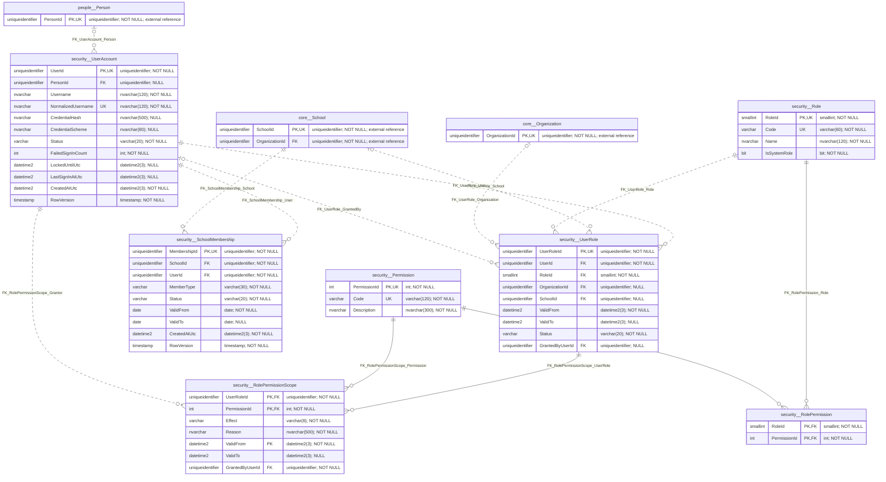

## transport

```mermaid
erDiagram
    core__FileObject {
        uniqueidentifier FileObjectId PK,UK "uniqueidentifier; NOT NULL; external reference"
        uniqueidentifier SchoolId FK "uniqueidentifier; NOT NULL; external reference"
    }
    core__School {
        uniqueidentifier SchoolId PK,UK "uniqueidentifier; NOT NULL; external reference"
    }
    people__EmployeeProfile {
        uniqueidentifier EmployeeId PK,UK "uniqueidentifier; NOT NULL; external reference"
        uniqueidentifier SchoolId FK "uniqueidentifier; NOT NULL; external reference"
    }
    people__StudentEnrollment {
        uniqueidentifier EnrollmentId PK,UK "uniqueidentifier; NOT NULL; external reference"
        uniqueidentifier SchoolId FK "uniqueidentifier; NOT NULL; external reference"
    }
    security__UserAccount {
        uniqueidentifier UserId PK,UK "uniqueidentifier; NOT NULL; external reference"
    }
    transport__RideNotice {
        uniqueidentifier RideNoticeId PK,UK "uniqueidentifier; NOT NULL"
        uniqueidentifier SchoolId FK "uniqueidentifier; NOT NULL"
        uniqueidentifier TransportEnrollmentId FK "uniqueidentifier; NOT NULL"
        date NoticeDate "date; NOT NULL"
        varchar Direction "varchar(20); NOT NULL"
        nvarchar Reason "nvarchar(500); NULL"
        varchar Status "varchar(20); NOT NULL"
        uniqueidentifier CreatedByUserId FK "uniqueidentifier; NOT NULL"
        datetime2 CreatedAtUtc "datetime2(3); NOT NULL"
        datetime2 CancelledAtUtc "datetime2(3); NULL"
    }
    transport__Route {
        uniqueidentifier RouteId PK,UK "uniqueidentifier; NOT NULL"
        uniqueidentifier SchoolId FK "uniqueidentifier; NOT NULL"
        nvarchar Code "nvarchar(40); NOT NULL"
        nvarchar Name "nvarchar(160); NOT NULL"
        varchar Status "varchar(20); NOT NULL"
    }
    transport__RouteRun {
        uniqueidentifier RouteRunId PK,UK "uniqueidentifier; NOT NULL"
        uniqueidentifier SchoolId FK "uniqueidentifier; NOT NULL"
        uniqueidentifier RouteId FK "uniqueidentifier; NOT NULL"
        uniqueidentifier VehicleId FK "uniqueidentifier; NOT NULL"
        uniqueidentifier DriverEmployeeId FK "uniqueidentifier; NOT NULL"
        date RunDate "date; NOT NULL"
        varchar Direction "varchar(20); NOT NULL"
        varchar Status "varchar(20); NOT NULL"
        datetime2 StartedAtUtc "datetime2(3); NULL"
        datetime2 CompletedAtUtc "datetime2(3); NULL"
    }
    transport__RouteStop {
        uniqueidentifier RouteStopId PK,UK "uniqueidentifier; NOT NULL"
        uniqueidentifier SchoolId FK "uniqueidentifier; NOT NULL"
        uniqueidentifier RouteId FK "uniqueidentifier; NOT NULL"
        smallint SequenceNo "smallint; NOT NULL"
        nvarchar Name "nvarchar(160); NOT NULL"
        decimal Latitude "decimal(9,6); NULL"
        decimal Longitude "decimal(9,6); NULL"
        time PlannedArrival "time(0); NULL"
    }
    transport__RunChaperone {
        uniqueidentifier RunChaperoneId PK,UK "uniqueidentifier; NOT NULL"
        uniqueidentifier SchoolId FK "uniqueidentifier; NOT NULL"
        uniqueidentifier RouteRunId FK "uniqueidentifier; NOT NULL"
        uniqueidentifier EmployeeId FK "uniqueidentifier; NOT NULL"
    }
    transport__StudentRide {
        uniqueidentifier StudentRideId PK,UK "uniqueidentifier; NOT NULL"
        uniqueidentifier SchoolId FK "uniqueidentifier; NOT NULL"
        uniqueidentifier RouteRunId FK "uniqueidentifier; NOT NULL"
        uniqueidentifier TransportEnrollmentId FK "uniqueidentifier; NOT NULL"
        datetime2 BoardedAtUtc "datetime2(3); NULL"
        datetime2 AlightedAtUtc "datetime2(3); NULL"
        uniqueidentifier RecordedByUserId FK "uniqueidentifier; NOT NULL"
    }
    transport__TransportEnrollment {
        uniqueidentifier TransportEnrollmentId PK,UK "uniqueidentifier; NOT NULL"
        uniqueidentifier SchoolId FK "uniqueidentifier; NOT NULL"
        uniqueidentifier StudentEnrollmentId FK "uniqueidentifier; NOT NULL"
        uniqueidentifier RouteId FK "uniqueidentifier; NOT NULL"
        uniqueidentifier PickupRouteStopId FK "uniqueidentifier; NOT NULL"
        uniqueidentifier DropoffRouteStopId FK "uniqueidentifier; NOT NULL"
        date ValidFrom "date; NOT NULL"
        date ValidTo "date; NULL"
        varchar Status "varchar(20); NOT NULL"
    }
    transport__Vehicle {
        uniqueidentifier VehicleId PK,UK "uniqueidentifier; NOT NULL"
        uniqueidentifier SchoolId FK "uniqueidentifier; NOT NULL"
        nvarchar RegistrationNo "nvarchar(50); NOT NULL"
        smallint Capacity "smallint; NOT NULL"
        varchar Status "varchar(20); NOT NULL"
    }
    transport__VehicleDocument {
        uniqueidentifier VehicleDocumentId PK,UK "uniqueidentifier; NOT NULL"
        uniqueidentifier SchoolId FK "uniqueidentifier; NOT NULL"
        uniqueidentifier VehicleId FK "uniqueidentifier; NOT NULL"
        varchar DocumentType "varchar(50); NOT NULL"
        uniqueidentifier FileObjectId FK "uniqueidentifier; NOT NULL"
        date ExpiresOn "date; NOT NULL"
    }
    transport__VehicleMaintenance {
        uniqueidentifier VehicleMaintenanceId PK,UK "uniqueidentifier; NOT NULL"
        uniqueidentifier SchoolId FK "uniqueidentifier; NOT NULL"
        uniqueidentifier VehicleId FK "uniqueidentifier; NOT NULL"
        date ServiceDate "date; NOT NULL"
        nvarchar Description "nvarchar(2000); NOT NULL"
        decimal Cost "decimal(19,4); NOT NULL"
        char CurrencyCode "char(3); NOT NULL"
        int OdometerKm "int; NULL"
    }
    transport__TransportEnrollment ||..o{ transport__RideNotice : "FK_RideNotice_Enrollment"
    security__UserAccount ||..o{ transport__RideNotice : "FK_RideNotice_User"
    core__School ||..o{ transport__Route : "FK_Route_School"
    people__EmployeeProfile ||..o{ transport__RouteRun : "FK_RouteRun_Driver"
    transport__Route ||..o{ transport__RouteRun : "FK_RouteRun_Route"
    transport__Vehicle ||..o{ transport__RouteRun : "FK_RouteRun_Vehicle"
    transport__Route ||..o{ transport__RouteStop : "FK_RouteStop_Route"
    people__EmployeeProfile ||..o{ transport__RunChaperone : "FK_RunChaperone_Employee"
    transport__RouteRun ||..o{ transport__RunChaperone : "FK_RunChaperone_Run"
    core__School ||..o{ transport__RunChaperone : "FK_RunChaperone_School"
    transport__TransportEnrollment ||..o{ transport__StudentRide : "FK_StudentRide_Enrollment"
    security__UserAccount ||..o{ transport__StudentRide : "FK_StudentRide_Recorder"
    transport__RouteRun ||..o{ transport__StudentRide : "FK_StudentRide_Run"
    core__School ||..o{ transport__StudentRide : "FK_StudentRide_School"
    transport__RouteStop ||..o{ transport__TransportEnrollment : "FK_TransportEnrollment_Dropoff"
    transport__RouteStop ||..o{ transport__TransportEnrollment : "FK_TransportEnrollment_Pickup"
    transport__Route ||..o{ transport__TransportEnrollment : "FK_TransportEnrollment_Route"
    people__StudentEnrollment ||..o{ transport__TransportEnrollment : "FK_TransportEnrollment_Student"
    core__School ||..o{ transport__Vehicle : "FK_Vehicle_School"
    core__FileObject ||..o{ transport__VehicleDocument : "FK_VehicleDocument_File"
    core__School ||..o{ transport__VehicleDocument : "FK_VehicleDocument_School"
    transport__Vehicle ||..o{ transport__VehicleDocument : "FK_VehicleDocument_Vehicle"
    core__School ||..o{ transport__VehicleMaintenance : "FK_VehicleMaintenance_School"
    transport__Vehicle ||..o{ transport__VehicleMaintenance : "FK_VehicleMaintenance_Vehicle"
```
